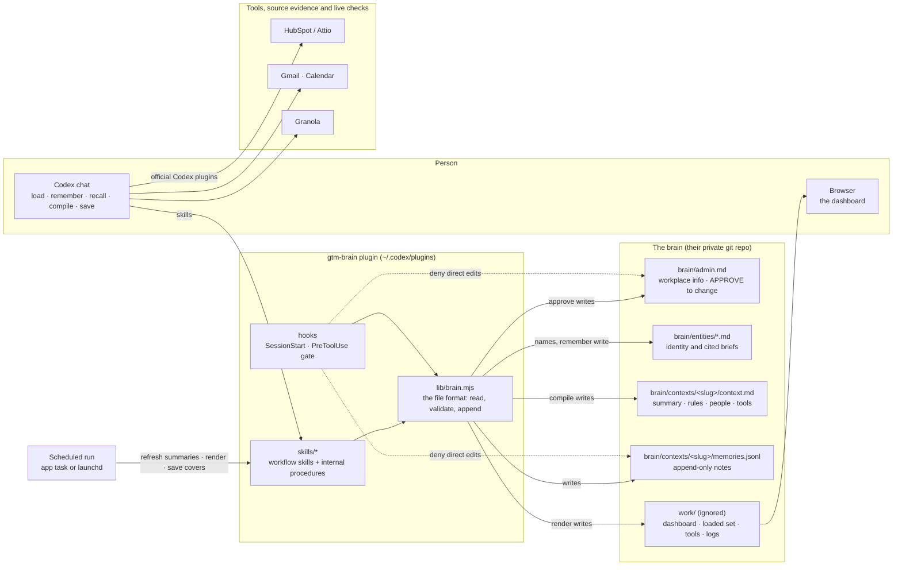
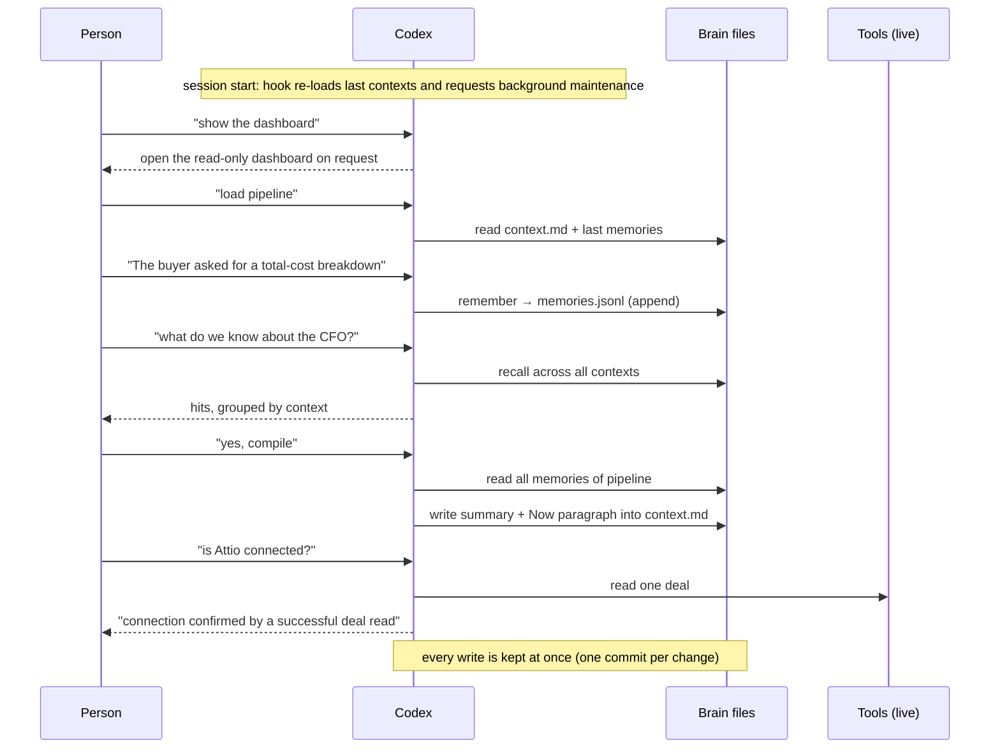

# Contributing to GTM Brain

GTM Brain installs as the `gtm-brain` plugin. This guide covers the plugin's architecture,
source layout and release checks. Start with [AGENTS.md](AGENTS.md) for contributor invariants
and [SETUP.md](SETUP.md) for local installation and verification.

## How it fits together



Three objects, shared library writers. Workflow skills coordinate small MCP operations, with detailed internal procedures loaded as needed; every write goes
through `lib/brain.mjs`, with two named exceptions (`setup` composes the first `admin.md` from
its template, `approve` replaces it after APPROVE); the hooks deny the model any other route to
the protected files. Memories retain append-only evidence; entity files maintain identities and
cited briefs; context covers are compiled from memories. The dashboard reads all three objects.



Notes are saved immediately. The background worker batches summary updates after ten minutes
without a new note by default (`GTM_BRAIN_COMPILE_DELAY=600`); another note extends the wait.
An explicit refresh can run sooner. Opening a chat does not automatically open the dashboard.

## Layout

```
.agents/plugins/marketplace.json
plugins/gtm-brain/
  .codex-plugin/plugin.json
  hooks.json  hooks/          SessionStart (list contexts), PreToolUse (protect admin, memories);
                              trust-hooks.mjs approves them in Codex, which installing does not do
  .mcp.json  server/          the operations as MCP tools (Remembering, Searching the brain, ...);
                              dash.mjs serves the read-only dashboard and revision events
  lib/                        the file format: read, append, write covers, commit; no dependencies
  skills/                     the thirteen workflows a person can ask for (all prefixed gtm-brain-): start,
                              todo, sync, workflow, deepdive, strategy, unit-economics,
                              market-desk-research, project, configure, skill, document, use-brain; what
                              they used to be as separate skills lives on as their references
    gtm-brain-use-brain/references/    load, create and edit contexts, remember, recall, names, compile,
                              dashboard, manual save
    gtm-brain-configure/references/ workplace approval, connect tools, update plugin
    gtm-brain-start/references/  onboarding, the handoff import
  scripts/gtm-brain-*/           the operation scripts the MCP server, hooks and skills run (no SKILL.md)
  templates/                  AGENTS.md, brain/admin.md, .gitignore, the pre-commit hook
  test/                       node --test 'plugins/gtm-brain/test/*.test.mjs'
dev-install.sh                install this checkout into Codex, no GitHub round trip
```

The plugin ships from `gtm-week/gtm-brain`, branch `main`.

Describe a feature in its owning reference and link to it from the other guides. Shared
agent policies are embedded automatically where an agent needs a self-contained document.

## Before pushing to main

`./dev-install.sh` points git at [.githooks/](.githooks/). Before a push to `main`, the pre-push
hook runs the test suite, then [the harness bench](plugins/gtm-brain/test/live/harness-bench.mjs)
when the push changes what ships. The bench runs three tasks (a coding fix, a logic puzzle, a
connector question) through `codex exec` without the plugin, with it in an ordinary folder and
in a brain, in throwaway Codex profiles with this checkout installed. It fails when the plugin
costs solved tasks, adds more prompt tokens than `GTM_BRAIN_BENCH_MAX_OVERHEAD` (default 14000) or
calls GTM Brain tools for the puzzle. Traces of every run stay in its artifacts folder.
`GTM_BRAIN_SKIP_BENCH=1 git push` skips it.
Then [the Claude Code smoke](plugins/gtm-brain/test/live/claude-smoke.mjs) runs this checkout in `claude -p`
(setup, the guard on `admin.md`, "go ahead" refused, APPROVE applied), so a fix for one host
cannot quietly break the other. `GTM_BRAIN_SKIP_CLAUDE=1 git push` skips it.

## Maintaining shared text and schemas

Run `node scripts/sync-derived.mjs` after changing either source below. Commit the source
and its generated changes together. `node scripts/sync-derived.mjs --check` reports drift
without writing; the normal test suite runs that check too.

- Question and Computer Use policy sources live in [plugins/gtm-brain/policies/](plugins/gtm-brain/policies/).
  The script fills marked blocks in contributor instructions, installation instructions,
  the brain template and the question reference. The session hook reads these sources
  directly for both empty folders and existing brains.
- In [the ontology](plugins/gtm-brain/ontology/gtm-brain.ossie.json), edit the single-memory fields
  under `remember.input_schema.properties`. The script derives `memories.items.properties`
  from them, excluding the call-level `by`, `project` and batch envelope. The static JSON
  remains ready for the tool generator; edit only the single-memory field definitions.

[The compatibility manifest](plugins/gtm-brain/templates/legacy/manifest.json) is the upgrade
matrix for both runtime and tests. Before editing the brain template, snapshot its outgoing
contents as `templates/legacy/AGENTS-<old version>.md` and add the manifest entry. Identical
releases may share one file (0.8.1 and 0.8.2 do). These are immutable fixtures, excluded from
policy generation: exact comparison lets upgrades preserve personal instruction edits.
Bump the plugin version and the paths in SETUP.md and COMMANDS.md when shipping changes.
For each module release, follow the update invariants and release checks:
users start fresh on the first participant release; preserve their data and entry points through
subsequent releases, validate before installation, and keep brain refresh repeatable.
