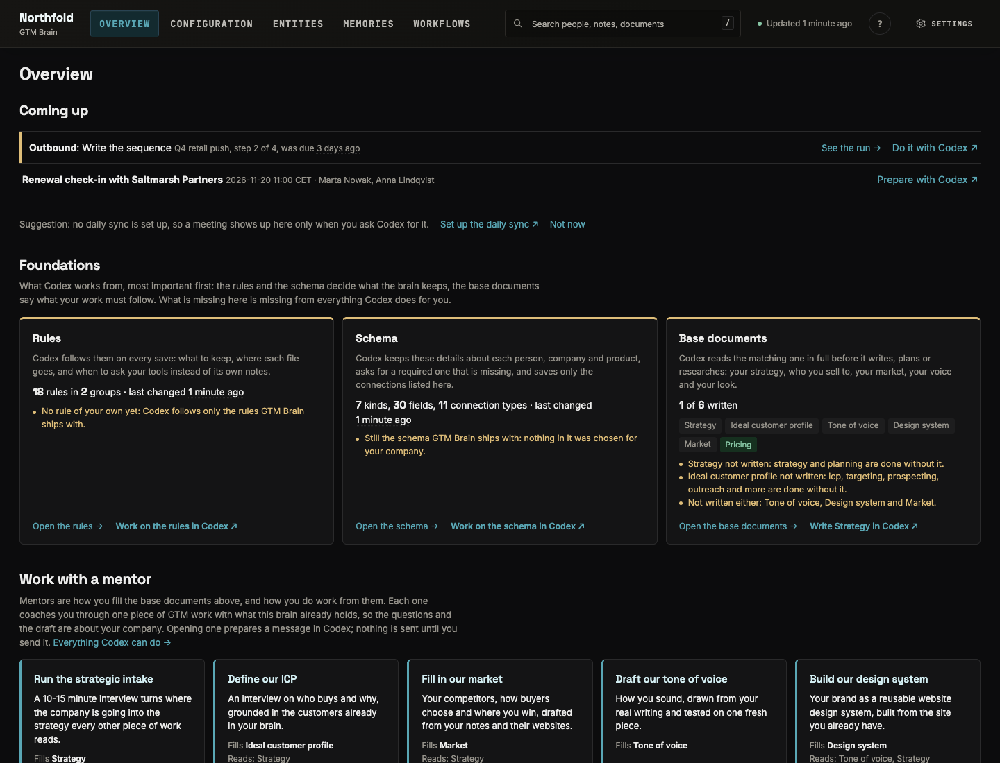

<a href="https://gtm-brain.ai/"></a>

# GTM Brain

[Website](https://gtm-brain.ai/) · [Install](#install) · [Start](#start) · [Set it up](#set-it-up) · [Every day](#use-it-every-day) · [Dashboard](#the-dashboard) · [Learn more](#learn-more)

GTM Brain gives Codex a memory for your go-to-market work. It is for founders, sales and
marketing people and GTM engineers who are tired of pasting their ideal customer profile into
every new chat and digging up the last customer call. It keeps your rules, your strategy, what
customers said and where each campaign stands in plain files in a folder on your computer, and
Codex reads and saves them for you in every chat. It installs as the `gtm-brain` plugin, is open
source under [MIT](LICENSE), and also runs in Claude Code (beta).

![The brain in one picture. Configuration, on the left, says what is allowed: it sets the fields and kinds of entities and checks every save into memories, and it changes only when you edit the file or approve a change Codex proposes. Entities are who and what the memories are about; names resolve and links derive from the memories. Codex, where you talk, is the only thing that reads your tools, reads the brain and saves into it. Notes and entities keep a link back to their source in your tools. Workflows, underneath, run through Codex under the rules and save each step as a note.](docs/images/brain-in-one-picture.svg)

In short: your settings and rules on the left decide what is kept. In the middle are the notes
(what happened) and the people and companies they are about. Codex is the only thing that reads
your tools and writes to the brain. The picture in words: [How GTM Brain works](docs/HOW-IT-WORKS.md).

## Install

You need the **Codex desktop app** and **Node 22.16+ (22.x) or Node 24+**. The installer checks
both. Already have GTM Brain? Do not install again: see [Update](#update).

Open a new Codex chat and send:

```text
Read https://github.com/gtm-week/gtm-brain/blob/main/INSTALL.md and follow it exactly. Read nothing else in that repository.
```

Follow the setup and permission prompts. No GitHub account or sign-in is needed. Installing by
hand, or in Claude Code: [SETUP.md](docs/SETUP.md).

## Start

Open a new Codex chat in an empty folder and send `/gtmb-start`. It creates the brain in that
folder, asks about your business and connects your tools (CRM, email, calendar), one short
question at a time.

## Set it up

Do these in order. Each is a command you type in a Codex chat opened in the brain's folder, or a
sentence you say there.

### 1. Rules and schema

These two decide what the brain keeps. **Rules** (`/gtmb-rules`) say what Codex saves, what it
asks before saving and where files go ("from now on, ask before saving anything about pricing").
The **schema** (`/gtmb-schema`) says what is kept about each person and company ("every company
must have a budget owner").

```text
/gtmb-rules
/gtmb-schema
```

### 2. Base documents

Five short documents steer all the work: **strategy**, **ideal customer profile** (who buys and
why), **market** (who you compete with), **tone of voice** and **design system** (how your pages
look). They start as empty templates. Codex reads the matching one in full before every email,
plan and page, so what is not written there is missing from all of that work.

### 3. Mentors fill them

A mentor is a skill that coaches you through one document. It reads what the brain already
knows, so its questions and its draft are about your company, not a template.

| Document | Command | What you get |
| --- | --- | --- |
| Strategy | `/gtmb-strategy` | A 10-15 minute interview, then your strategy written down |
| Ideal customer profile | `/gtmb-icp` | One draft profile with segments and buying roles |
| Market | `/gtmb-market` | Competitors, how buyers choose, where you win and lose |
| Tone of voice | `/gtmb-voice` | Your voice, drawn from your real writing and tested on one piece |
| Design system | `/gtmb-design-system` | Your brand as a reusable website design system |

Four more mentors use those documents: `/gtmb-market-research`, `/gtmb-unit-economics`,
`/gtmb-deepdive` (a one-page account brief) and `/gtmb-build-landing-page`. All twenty-nine
skills are in [SKILLS.md](docs/SKILLS.md).

## Use it every day

Work as usual and talk in plain sentences. You never need to say "remember".

- "Just got off a call with Anna Lind at Acme Retail: they want a pilot in March." Saved as a
  dated note with its source.
- "What do we know about pricing?" An answer from your notes, with dates and sources.
- "Brief me on Acme Retail." One page: where things stand, who is involved, what is open.
- "What is waiting on me?" Your open questions and follow-ups, one at a time.
- "Open the dashboard." The page below.
- "Start the outbound workflow." A campaign with steps; the brain keeps track of where it stands
  across chats.

Codex never guesses who someone is or invents a fact: when something is unclear, it saves what
you said and asks. More sentences: [GUIDE.md](docs/GUIDE.md).

## The dashboard



Say "open the dashboard". It shows what needs you, what is coming up and what the brain holds,
from the same files Codex reads. A button prepares a message in Codex; nothing happens until you
press Send. Each tab: [The dashboard](docs/GUIDE.md#the-dashboard).

## Update

1. Say "update GTM Brain" in Codex, then quit and reopen Codex.
2. Start a new chat in the brain folder. The first reply says what was refreshed. If it offers to
   upgrade the brain, say "upgrade the brain": it moves the files into four folders and asks
   before anything moves.

Old skill names still work. Details: [Updating to 0.37](plugins/gtm-brain/MANUAL.md#updating-to-037-the-four-folders).
Still on the old plugin name, `gtm-os`? See [MIGRATING.md](docs/MIGRATING.md).

## Learn more

- [How GTM Brain works](docs/HOW-IT-WORKS.md): the four parts, how they fit, what is on disk.
- [SKILLS.md](docs/SKILLS.md): all twenty-nine skills, with what to say for each.
- [ONBOARDING.md](docs/ONBOARDING.md): the first-use walkthrough, step by step.
- [GUIDE.md](docs/GUIDE.md): everyday use, the dashboard, your tools and sync.
- [The manual](plugins/gtm-brain/MANUAL.md): how a brain works and how to change it.
- [DOCUMENTS.md](docs/DOCUMENTS.md): the base documents and your own.
- [WORKFLOWS.md](docs/WORKFLOWS.md): campaigns and playbooks with steps.
- [USER-SKILLS.md](docs/USER-SKILLS.md): skills you make yourself.
- [COMMANDS.md](docs/COMMANDS.md): every tool and the files it writes.
- [SETUP.md](docs/SETUP.md): manual install, Claude Code (beta) and verification.
- [All documentation](docs/README.md) · [Contributing](.github/CONTRIBUTING.md) · [Open an issue](https://github.com/gtm-week/gtm-brain/issues)

## License

[MIT](LICENSE). Bundled dashboard dependencies and fonts retain their own licenses:
[third-party notices](plugins/gtm-brain/scripts/gtm-brain-render/ui/THIRD-PARTY-NOTICES.md),
[font license](plugins/gtm-brain/scripts/gtm-brain-render/ui/FONT-LICENSE.md) and
[shadcn license](plugins/gtm-brain/scripts/gtm-brain-render/ui/SHADCN-LICENSE.md).
