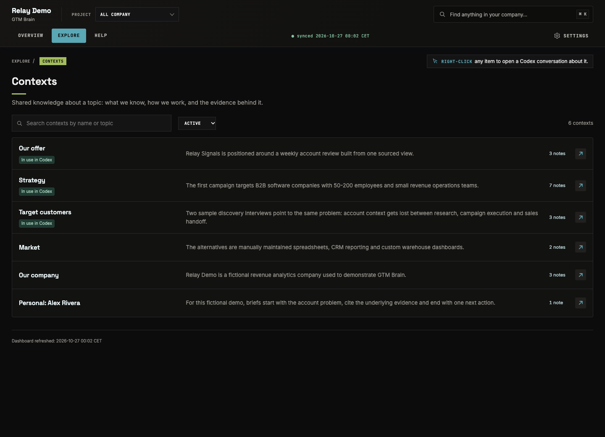
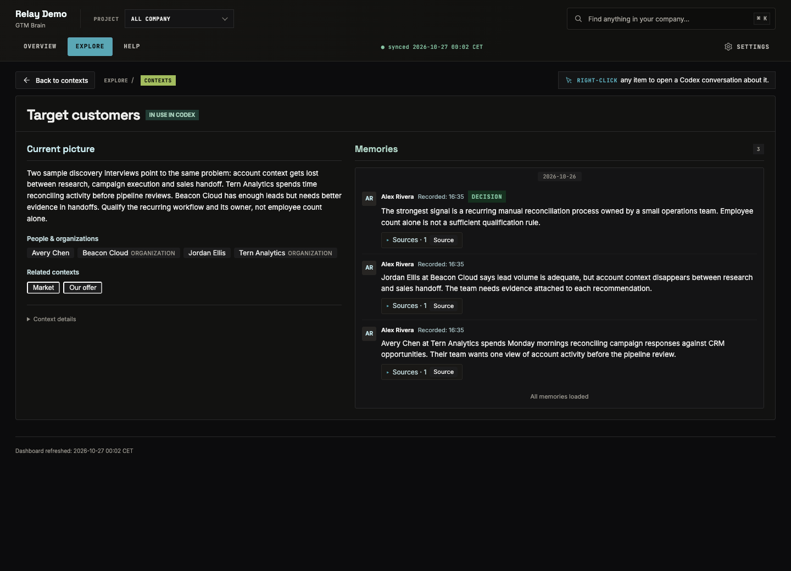
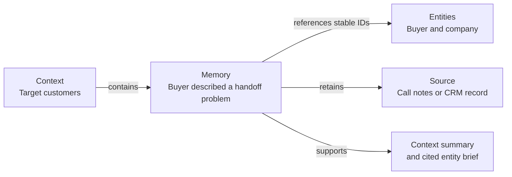
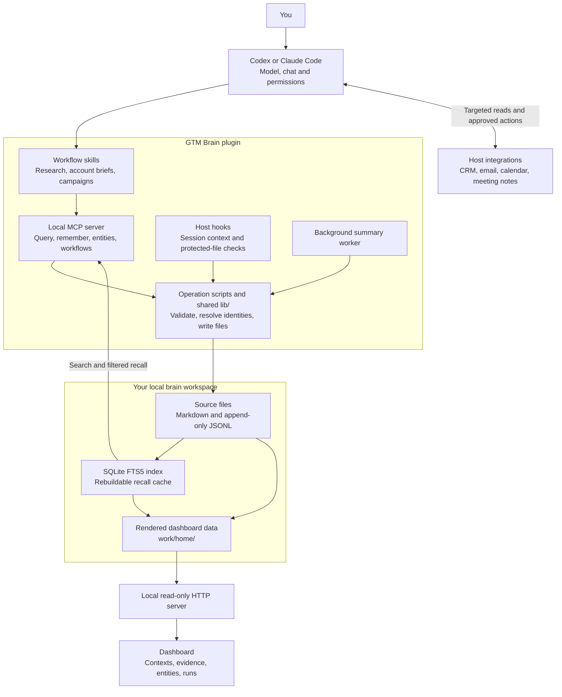
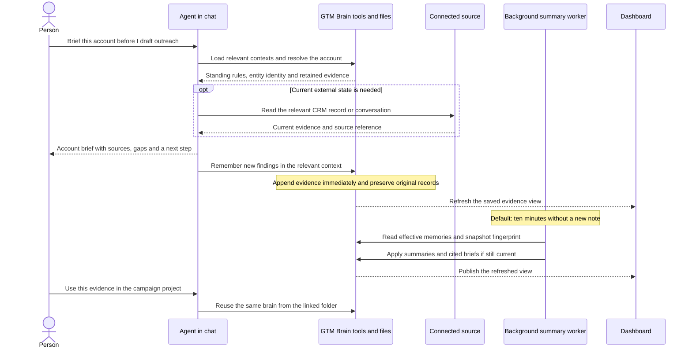

<a href="https://gtm-brain.ai/"></a>

# GTM Brain

[Website](https://gtm-brain.ai/) · [Install](#install-in-codex) · [Screenshots](#the-dashboard) · [Architecture](#how-it-fits-together) · [Workflows](#built-in-workflows)

**For GTM engineers building research, account and campaign workflows in Codex.**

A new chat should not mean pasting your ICP again, hunting down the last customer conversation,
or reconstructing where a playbook stopped. GTM Brain keeps your ICP, offer, customer evidence
and playbook progress in local files that your agent can use across chats and linked projects.

It installs as the **`gtm-brain` plugin**. Open source under [MIT](LICENSE).
[Codex](#install-in-codex) is the primary host; [Claude Code support is in beta](#claude-code-beta).

## What it solves

| The work you keep repeating | What GTM Brain does |
| --- | --- |
| **Re-explaining who you sell to and why you win.** Every research or campaign chat needs the same ICP, offer, proof and messaging rules. | Keeps those as standing documents and shared context. Linked project folders use the same brain, so a new project can reuse what you have already established. |
| **Reconstructing an account from CRM records, emails and call notes.** The useful detail is scattered, and yesterday's summary may miss today's change. | Builds a sourced account brief from retained evidence and targeted reads of connected tools: where things stand, who is involved, what happened and what remains unanswered. |
| **Losing the state of a multi-step GTM playbook.** The prompt is saved, but which step ran, what is due and what needs approval are not. | Keeps reusable playbooks with tracked runs, steps, dates and approval gates. Resume a run in chat with its recorded progress. |
| **Getting a GTM recommendation you cannot check.** Market claims lack evidence; CAC and LTV use incompatible inputs. | Runs sourced market research and unit-economics reviews that expose evidence, assumptions and missing inputs. You can inspect the basis for the conclusion. |

## The dashboard

The dashboard makes the agent's working knowledge inspectable: contexts, source-backed memories,
people and companies, decisions, open questions and workflow progress. Work happens in chat;
the dashboard is a read-only view of the same files.

**Actual GTM Brain dashboard, populated with fictional demo data.** These are captures
of the shipped app, not mockups. No customer or private workspace data is shown.





## Install in Codex

Already using the previous plugin? Follow the [rename migration](MIGRATING.md) to keep your existing brain and switch installations safely.

Requires the **Codex desktop app** and **Node 22.16+ (22.x) or Node 24+**. The guided installer checks your environment.

Open a new Codex chat and send:

```text
Read https://github.com/gtm-week/gtm-brain/blob/main/INSTALL.md and follow it exactly. Read nothing else in that repository.
```

Follow the setup and permission prompts. Codex installs the plugin, opens your working folder,
and guides you through your business context and tool connections. No GitHub invitation or
sign-in is required to download the plugin.

[First-use walkthrough](ONBOARDING.md) · [Everyday guide](GUIDE.md) · [Manual installation](#manual-installation)

## Put it to work

These are example requests, not preloaded data. The answers depend on the context you provide
and the tools you connect.

### Before an account meeting

> Brief me on this account. What did they ask for, who is involved, and what is still unanswered?

Get a one-page brief with a dated timeline, source links, open questions and a proposed next
step. The agent checks the relevant connected sources when the answer needs current information.

### Before entering a new segment

> Research this segment against our ICP and offer. What are the buying pains, who buys, and what evidence supports the fit?

Get a sourced market diagnosis that uses your existing strategy and customer evidence.
Findings, hypotheses and gaps stay separate, so a plausible market story does not pass as proof.

### When a campaign spans more than one chat

> Turn this outbound process into a playbook with steps and approval gates. Then show me where the current run stands.

Keep the process and each run's progress together. The agent can carry out a step through a
connected tool with the required permission, or record a step you completed yourself.
Playbooks track work; execution happens in chat, with human decisions where the process requires them.

### Before increasing acquisition spend

> Compare CAC, LTV and payback for paid search, outbound and referrals. Show the inputs and assumptions. Where should we push, fix, stop or measure?

Get a unit-economics review with comparable periods, explicit assumptions and missing data
called out. The review makes a recommendation; budget and campaign changes remain separate actions.

### After a useful process becomes repeatable

> Make this research process a skill I can reuse in our other projects.

Keep your own skills in the brain and use them from linked project folders. Plugin updates
preserve them. See the [command reference](COMMANDS.md) for all thirteen workflows, including
strategy, source sync, documents and project setup.

## How GTM Brain works

GTM Brain is a plugin that gives your agent a persistent, structured workspace for GTM work.
The host provides the model, chat, permissions and connected tools. GTM Brain provides the
workflows, memory operations, local files and dashboard. There is no separate hosted GTM Brain
backend to provision.

### Three formal objects

| Object | What it holds | Where it lives |
| --- | --- | --- |
| **Context** | Shared knowledge about a topic: a summary, standing instructions, learned working guidance, mentioned entities, tools and related contexts. Examples: Target customers, Our offer, Strategy. | `brain/contexts/<slug>/context.md` |
| **Memory** | One dated record of evidence, a decision, a completed action or a question. Includes author, source references, entities, tools and optional action metadata. | `brain/contexts/<slug>/memories.jsonl` |
| **Entity** | A stable identity for a person, organization or product: name, aliases, contacts, external references and a cited brief across contexts. Companies and teams are organization subtypes. | `brain/entities/*.md` |



The context answers **what topic are we working on?** The memory answers **what happened,
who said it, and where is the evidence?** The entity answers **which person, company or product
is this, across all our work?** A company does not automatically become a separate context.
Customer, partner and employer are relationships supported by memories, not extra identity types.

Alongside these objects:

- **Workplace settings** in `brain/admin.md` describe the company, team and tools. Changes require `APPROVE`.
- **Documents** such as `strategy.md`, an ICP or pricing guide are standing instructions for future work. They carry a `kind: document` marker and are authored by people, not rewritten by summary compilation. Their supporting files live beside them.
- **Workflows** in `workflows/` describe repeatable steps, prerequisites, gates and learning questions. Each run's state is recorded as memories in its context.
- **Projects** are working folders linked to the same brain. Each has its own loaded contexts; its notes carry a `project:<slug>` tag. Linking a campaign folder does not create a second memory store.

### How it fits together



**Skills coordinate the work.** They tell the agent how to research, brief an account, review
unit economics or advance a playbook. Detailed procedures are loaded when needed. The agent
calls small MCP operations; operation scripts use shared library readers, validators and writers.

**Files retain the evidence.** Memory writes append to JSONL immediately. Corrections add a
new record with `supersedes`; withdrawals and answered questions use `retracts`. Historical
records remain intact. Entity identities link those records across contexts without copying
the underlying facts into another database of truth.

**The index makes recall practical.** A local SQLite FTS5 index supports keyword search,
alias expansion, exact filters and read-only SQL for counts, joins and dates. It is a rebuildable
cache under `work/`; Markdown and JSONL remain authoritative. Entity briefs combine evidence
across contexts, while individual claims retain their context and memory citations.

**The dashboard renders the same state.** A Node renderer builds dashboard data from the brain
and index. A local server serves the prebuilt React interface and revision events so open views
can update. The dashboard does not execute campaigns or write memories. Its chat links prepare
a request in Codex for you to review and send.

### From a call note to the next campaign



A new chat restores the working context through the session hook. Loading a context brings in
its standing rules, summary, working guidance and recent memories. It does not load every
transcript or every account into the prompt. Broader recall searches across the brain when needed.

Notes are saved immediately. By default, summary work starts after **ten minutes without a
new note** (`GTM_BRAIN_COMPILE_DELAY=600`); another note extends the wait. An explicit refresh
can run sooner. Compilation uses a snapshot fingerprint and refuses an out-of-date write if
the evidence or cover changed while it was working. Hand edits to generated summaries pause
automatic replacement until reviewed. Refreshing a summary is not a live check of its sources.

### What is stored on disk

```text
your-brain/
  AGENTS.md                         Workspace instructions for the agent
  CLAUDE.md                         Claude Code entry point
  brain/
    admin.md                        Company, team, tools and settings
    contexts/
      icp/
        context.md                  Summary, standing rules, working guidance
        memories.jsonl              Append-only evidence, decisions and questions
      offer/ ...                    Other shared contexts
    entities/
      <entity>.md                   Stable identity and cited cross-context brief
      .history/                     Identity merge and recovery records
  strategy.md                       A standing document (kind: document)
  strategy/                         Files belonging to that document
  workflows/
    outbound.md                     Playbook definition; run state lives in memories
  .agents/skills/                    Your own reusable skills
  work/                             Local state and caches, ignored by version control
    memory-index.sqlite             Rebuildable SQLite search index
    loaded-contexts.json             Working context selection
    home/                           Rendered dashboard and data
```

The plugin's source and your brain are separate folders. Updating the plugin does not replace
your memories, documents or custom skills. The brain keeps local version history; remote
sharing and backup depend on how you configure your workspace.

### Sources, permissions and boundaries

CRM, email, calendar and meeting sources come through the host's connected integrations,
with their own accounts and permissions. GTM Brain retains useful findings and exact source
references; it does not mirror every record. Broad source sync runs on request or on an
approved schedule. A targeted live read is used when an operational answer needs current state.

Customer evidence can exist without a CRM record. The Customers view includes retained
relationships and scoped coverage. Meeting records distinguish scheduled events from evidence
that a conversation happened, and distinguish available notes or transcripts from missing content.
Neither a cached summary nor a calendar invitation proves the current state of an account.

Protected workplace changes are proposed first and applied after you type `APPROVE` in chat.
The host hooks guard direct agent edits to protected files; installation requires explicit hook
trust. These checks complement the host's permission system. External sends, account changes
and other actions still go through the relevant integration and its permission flow.

The dashboard is read-only and opens when requested. A workflow records prerequisites, step
progress, dates and approval gates; its tracker does not autonomously perform the step. The
agent carries out authorized work through connected tools and then records what happened.

Relevant content is processed by your AI host and connected services. Local file ownership
does not mean offline AI processing.

## Built-in workflows

Ask for an outcome in ordinary language, or invoke one of the thirteen shipped skills:

| Command | Use it for |
| --- | --- |
| `/gtm-brain-start` | Set up the brain and continue first-use discovery. |
| `/gtm-brain-use-brain` | Recall evidence, save findings and resume everyday work. |
| `/gtm-brain-deepdive` | Build a sourced brief on an account, person, deal or context. |
| `/gtm-brain-market-desk-research` | Assess a segment, buying pains, alternatives and evidence for fit. |
| `/gtm-brain-unit-economics` | Compare CAC, LTV, payback and retention with explicit inputs and gaps. |
| `/gtm-brain-strategy` | Work through a strategic intake and maintain the strategy document. |
| `/gtm-brain-workflow` | Create a playbook, start a run and advance through its steps and gates. |
| `/gtm-brain-sync` | Pull relevant updates from connected sources and retain useful findings. |
| `/gtm-brain-todo` | Review what is waiting on you across the brain and connected tools. |
| `/gtm-brain-project` | Create or link a working folder to the shared brain. |
| `/gtm-brain-document` | Maintain the ICP, offer, pricing, voice and other standing documents. |
| `/gtm-brain-skill` | Turn a repeated process into your own reusable skill. |
| `/gtm-brain-configure` | Change workplace information, tools and settings through the approval flow. |

## Claude Code (beta)

In Claude Code, run:

```text
/plugin marketplace add gtm-week/gtm-brain
/plugin install gtm-brain@gtm-brain
```

In the Claude desktop app:

1. Choose Add marketplace and enter `https://github.com/gtm-week/gtm-brain.git`.
2. Click Sync, then install `gtm-brain`.
3. Open an empty folder, start a session and say: "Set up a company brain here."

Setup, memory, briefs, questions, linked projects and protected-file approvals are supported.
The dashboard opens as a link in your browser.

Current beta limitations:

- Background context summaries require Codex to be installed on the same machine.
- Marketplace updates are manual. From version 0.30.3, say "update GTM Brain" when prompted,
  then run `/reload-plugins`. On older versions, first run
  `claude plugin marketplace update gtm-brain && claude plugin update gtm-brain@gtm-brain`.
- Connector checks and the dashboard's chat buttons are Codex-only.
- Some skill instructions still name Codex.

## Manual installation

```bash
codex plugin marketplace add gtm-week/gtm-brain
codex plugin marketplace upgrade gtm-brain
codex plugin add gtm-brain@gtm-brain
node "$(ls -d ~/.codex/plugins/cache/gtm-brain/gtm-brain/*/ | sort -V | tail -1)hooks/trust-hooks.mjs" --trust
```

The upgrade line refreshes an existing marketplace snapshot. The final line explicitly approves
the plugin's hooks, which installation alone does not do. Without that approval, the installed
hooks do not run. In a new chat in an empty project folder, send "Set up GTM Brain here" or
`/gtm-brain-start`.

To verify the first use, ask the agent to remember a test finding, recall it in a new chat and
show the dashboard. The same record should appear in the context and the read-only view.
The installation bundles the dashboard assets; users do not need to build the frontend.

### Moving from GTM OS

For an existing `gtm-os` installation, use the migration below instead of setting up a new brain:

```bash
migration_dir="$(mktemp -d "${TMPDIR:-/tmp}/gtm-brain-migrate.XXXXXX")"
git clone --depth 1 https://github.com/gtm-week/gtm-brain.git "$migration_dir/source"
node "$migration_dir/source/scripts/migrate-install.mjs" codex
```

For Claude Code, replace the final `codex` argument with `claude`. The helper verifies the new
installation before retiring the old plugin. Restart the host, open the **same working folder**
and ask to refresh the brain rules. Existing memories, entities and custom skills stay in place;
built-in commands now start with `/gtm-brain-`. Personal schedules that reference old installation
paths need updating. [MIGRATING.md](MIGRATING.md) contains the full compatibility notes.


## Source layout

```
.agents/plugins/marketplace.json
plugins/gtm-brain/
  .codex-plugin/plugin.json
  hooks.json  hooks/          SessionStart (list contexts), PreToolUse (protect admin, memories);
                              trust-hooks.mjs approves them in Codex, which installing does not do
  .mcp.json  server/          the operations as MCP tools (Remembering, Searching the brain, ...);
                              dash.mjs serves the read-only dashboard and revision events
  lib/                        shared readers, validators, writers, search and identity logic; Node built-ins
  skills/                     the thirteen workflows a person can ask for (all prefixed gtm-brain-): start,
                              todo, sync, workflow, deepdive, strategy, unit-economics,
                              market-desk-research, project, configure, skill, document, use-brain; what
                              they used to be as separate skills lives on as their references
    gtm-brain-use-brain/references/    load, create and edit contexts, remember, recall, names, compile,
                              dashboard, manual save
    gtm-brain-configure/references/ workplace approval, connect tools, update plugin
    gtm-brain-start/references/  onboarding, the handoff import
  scripts/gtm-brain-*/           the operation scripts the MCP server, hooks and skills run (no SKILL.md)
  templates/                  AGENTS.md, brain/admin.md, .gitignore, the pre-commit hook
  test/                       node --test 'plugins/gtm-brain/test/*.test.mjs'
frontend/dashboard/           React dashboard source; built assets ship with the plugin
scripts/sync-derived.mjs       generate shared policy blocks, schemas and host declarations
dev-install.sh                install this checkout into Codex, no GitHub round trip
```

The plugin ships from `gtm-week/gtm-brain`, branch `main`.

Describe a feature in its owning reference and link to it from the other guides. Shared
agent policies are embedded automatically where an agent needs a self-contained document.

## Before pushing to main

`./dev-install.sh` points git at [.githooks/](.githooks/). Before a push to `main`, the pre-push
hook runs the test suite, then [the harness bench](plugins/gtm-brain/test/live/harness-bench.mjs)
when the push changes what ships. The bench runs three tasks (a coding fix, a logic puzzle, a
connector question) through `codex exec` without the plugin, with it in an ordinary folder and
in a brain, in throwaway Codex profiles with this checkout installed. It fails when the plugin
costs solved tasks, adds more prompt tokens than `GTM_BRAIN_BENCH_MAX_OVERHEAD` (default 14000) or
calls GTM Brain tools for the puzzle. Traces of every run stay in its artifacts folder.
`GTM_BRAIN_SKIP_BENCH=1 git push` skips it.
Then [the Claude Code smoke](plugins/gtm-brain/test/live/claude-smoke.mjs) runs this checkout in `claude -p`
(setup, the guard on `admin.md`, "go ahead" refused, APPROVE applied), so a fix for one host
cannot quietly break the other. `GTM_BRAIN_SKIP_CLAUDE=1 git push` skips it.

## Maintaining shared text and schemas

Run `node scripts/sync-derived.mjs` after changing either source below. Commit the source
and its generated changes together. `node scripts/sync-derived.mjs --check` reports drift
without writing; the normal test suite runs that check too.

- Question and Computer Use policy sources live in [plugins/gtm-brain/policies/](plugins/gtm-brain/policies/).
  The script fills marked blocks in contributor instructions, installation instructions,
  the brain template and the question reference. The session hook reads these sources
  directly for both empty folders and existing brains.
- In [the ontology](plugins/gtm-brain/ontology/gtm-brain.ossie.json), edit the single-memory fields
  under `remember.input_schema.properties`. The script derives `memories.items.properties`
  from them, excluding the call-level `by`, `project` and batch envelope. The static JSON
  remains ready for the tool generator; edit only the single-memory field definitions.

[The compatibility manifest](plugins/gtm-brain/templates/legacy/manifest.json) is the upgrade
matrix for both runtime and tests. Before editing the brain template, snapshot its outgoing
contents as `templates/legacy/AGENTS-<old version>.md` and add the manifest entry. Identical
releases may share one file (0.8.1 and 0.8.2 do). These are immutable fixtures, excluded from
policy generation: exact comparison lets upgrades preserve personal instruction edits.
Bump the plugin version and the paths in SETUP.md and COMMANDS.md when shipping changes.
For each module release, follow the update invariants and release checks:
users start fresh on the first participant release; preserve their data and entry points through
subsequent releases, validate before installation, and keep brain refresh repeatable.

## More reference material

The working model, architecture and install path are above. These guides expand individual operations:

| Document | Use it for |
| --- | --- |
| [ONBOARDING.md](ONBOARDING.md) | A step-by-step first-use walkthrough |
| [GUIDE.md](GUIDE.md) | Everyday examples and working conventions |
| [COMMANDS.md](COMMANDS.md) | Tool inputs, scripts and the files each operation changes |
| [INSTALL.md](INSTALL.md) | Standalone instructions for the installing agent |
| [SETUP.md](SETUP.md) | Additional installation and verification details |
| [CONTRIBUTING.md](CONTRIBUTING.md) | Contributor reference |

Found a problem or have a concrete workflow to improve? [Open an issue](https://github.com/gtm-week/gtm-brain/issues).

## License

[MIT](LICENSE). Bundled dashboard dependencies and fonts retain their own licenses:
[third-party notices](plugins/gtm-brain/scripts/gtm-brain-render/ui/THIRD-PARTY-NOTICES.md),
[font license](plugins/gtm-brain/scripts/gtm-brain-render/ui/FONT-LICENSE.md) and
[shadcn license](plugins/gtm-brain/scripts/gtm-brain-render/ui/SHADCN-LICENSE.md).
