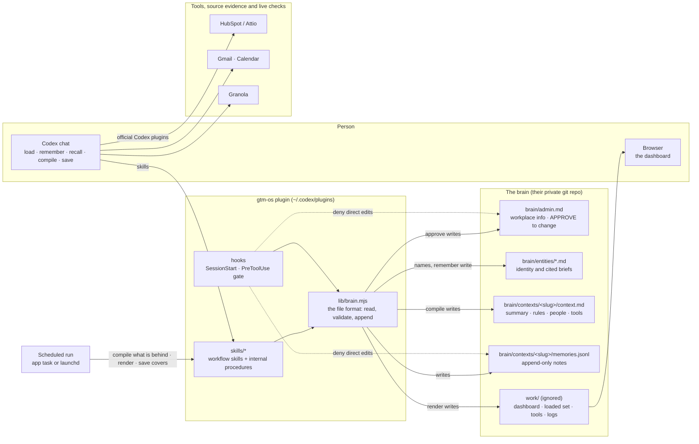
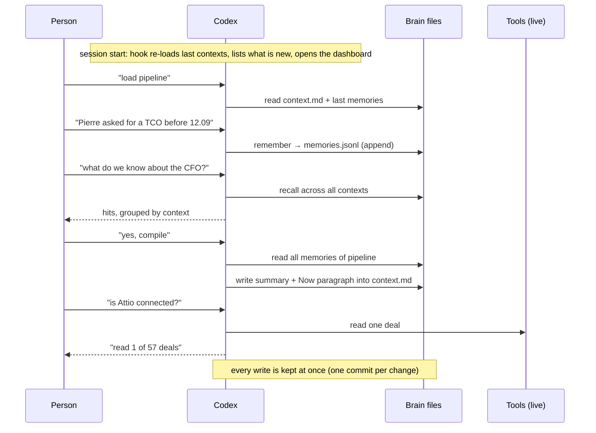

# GTM OS

GTM OS helps your team keep company knowledge, customer conversations and priorities in one place.

## Set up GTM OS in Codex

Open a new chat in the **Codex desktop app**, paste this prompt, and send it:

```text
Read https://github.com/gtm-week/gtm-os/blob/main/INSTALL.md and follow it exactly. Read nothing else in that repository.
```

Codex will install GTM OS, help you open your GTM OS project, and guide you through company
setup and connecting your tools. Follow the choices and permission prompts it shows.
You need GitHub access to this private repository.

For a walkthrough, see [Getting started](ONBOARDING.md).

## How GTM OS works

A company brain for a revenue team, as a Codex plugin. Three formal objects, kept in the team's own git repo:

- **Context**: a context of work (`pipeline`, `marketing`, `gtm`, yours). A cover page with a summary,
  how to behave when loaded, people mentioned, tools used, related contexts.
- **Memory**: one record in a context's append-only time series. Who, when, via what, which tools,
  which people, what happened.
- **Entity**: a person, organization or product with a stable ID, aliases and external references,
  stored in an editable Markdown file with a cited brief. Companies and teams are organization subtypes.

Plus **admin**: the workplace info (company, what we sell, to whom, team, tools), written at setup.

Customer, partner and employer describe relationships supported by context memories. Entities are
queryable through the ontology catalog and linked to those memories by stable IDs. Deals remain
context information; meetings/events will have a separate abstraction in a later version.
Customer identities, source links and dated relationship evidence are retained during onboarding, including customers absent from CRM. The Customers view shows known relationships and scoped coverage; current operational questions use live tools.

## How it fits together



Three objects, shared library writers. Workflow skills coordinate small MCP operations, with detailed internal procedures loaded as needed; every write goes
through `lib/brain.mjs`, with two named exceptions (`setup` composes the first `admin.md` from
its template, `approve` replaces it after APPROVE); the hooks deny the model any other route to
the protected files. Memories retain append-only evidence; entity files maintain identities and
cited briefs; context covers are compiled from memories. The dashboard reads all three objects.



## Manual installation

For the guided setup, use the Codex prompt at the top of this page.

By hand. The repo is private. Once, so git can reach it: `gh auth login && gh auth setup-git`
(`brew install gh` if missing). Then:

```bash
codex plugin marketplace add gtm-week/gtm-os
codex plugin add gtm-os@gtm-os
node "$(ls -d ~/.codex/plugins/cache/gtm-os/gtm-os/*/ | sort -V | tail -1)hooks/trust-hooks.mjs" --trust
```

The third line approves the plugin's hooks, which installing does not do: without it they are
installed and enabled but never run. Then, in a new chat in an empty project folder, send
"Set up GTM OS here" (or `/gtm-os-start`). `ONBOARDING.md` is the one page to hand a new
person: install to first use. `GUIDE.md` is the ten-minute guide for the person using it. `SETUP.md` is the install and test
manual, `COMMANDS.md` lists every command and what it touches.

## Layout

```
.agents/plugins/marketplace.json
plugins/gtm-os/
  .codex-plugin/plugin.json
  hooks.json  hooks/          SessionStart (list contexts), PreToolUse (protect admin, memories);
                              trust-hooks.mjs approves them in Codex, which installing does not do
  .mcp.json  server/          the operations as MCP tools (Remembering, Searching the brain, ...);
                              dash.mjs serves the read-only dashboard and revision events
  lib/                        the file format: read, append, write covers, commit; no dependencies
  skills/                     the ten workflows a person can ask for (all prefixed gtm-os-): start,
                              todo, sync, deepdive, project, configure, add-file, skill, guideline,
                              use-brain; what
                              they used to be as separate skills lives on as their references
    gtm-os-use-brain/references/    load, create and edit contexts, remember, recall, names, compile,
                              dashboard, manual save
    gtm-os-configure/references/ workplace approval, connect tools, update plugin
    gtm-os-start/references/  onboarding, the handoff import
  scripts/gtm-os-*/           the operation scripts the MCP server, hooks and skills run (no SKILL.md)
  templates/                  AGENTS.md, brain/admin.md, .gitignore, the pre-commit hook
  test/                       node --test 'plugins/gtm-os/test/*.test.mjs' 
dev-install.sh                install this checkout into Codex, no GitHub round trip
```

The plugin ships from `gtm-week/gtm-os`, branch `main`.

| Document | Purpose |
| --- | --- |
| [INSTALL.md](INSTALL.md) | Standalone instructions for the installing agent |
| [ONBOARDING.md](ONBOARDING.md) | Guided first-use walkthrough |
| [GUIDE.md](GUIDE.md) | Everyday usage for the person using the brain |
| [COMMANDS.md](COMMANDS.md) | Tool and command reference, including files written |
| [SETUP.md](SETUP.md) | Manual installation and contributor verification |

Describe a feature in its owning reference and link to it from the other guides. Shared
agent policies are embedded automatically where an agent needs a self-contained document.

## Maintaining shared text and schemas

Run `node scripts/sync-derived.mjs` after changing either source below. Commit the source
and its generated changes together. `node scripts/sync-derived.mjs --check` reports drift
without writing; the normal test suite runs that check too.

- Question and Computer Use policy sources live in [plugins/gtm-os/policies/](plugins/gtm-os/policies/).
  The script fills marked blocks in contributor instructions, installation instructions,
  the brain template and the question reference. The session hook reads these sources
  directly for both empty folders and existing brains.
- In [the ontology](plugins/gtm-os/ontology/gtm-os.ossie.json), edit the single-memory fields
  under `remember.input_schema.properties`. The script derives `memories.items.properties`
  from them, excluding the call-level `by`, `project` and batch envelope. The static JSON
  remains ready for the tool generator; edit only the single-memory field definitions.

[The compatibility manifest](plugins/gtm-os/templates/legacy/manifest.json) is the upgrade
matrix for both runtime and tests. Before editing the brain template, snapshot its outgoing
contents as `templates/legacy/AGENTS-<old version>.md` and add the manifest entry. Identical
releases may share one file (0.8.1 and 0.8.2 do). These are immutable fixtures, excluded from
policy generation: exact comparison lets upgrades preserve personal instruction edits.
Bump the plugin version and the paths in SETUP.md and COMMANDS.md when shipping changes.
For each module release, follow the update invariants and release checks:
users start fresh on the first participant release; preserve their data and entry points through
subsequent releases, validate before installation, and keep brain refresh repeatable.
