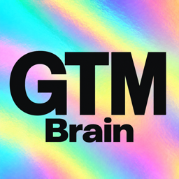

<a href="https://gtm-brain.ai/"></a>

# GTM Brain

[Website](https://gtm-brain.ai/) · [Install](#install-in-codex) · [Design direction](DESIGN.md)

**For GTM engineers building research, account and campaign workflows in Codex.**

A new chat should not mean pasting your ICP again, hunting down the last customer conversation,
or reconstructing where a playbook stopped. GTM Brain keeps your ICP, offer, customer evidence
and playbook progress in local files that your agent can use across chats and linked projects.

It installs as the **`gtm-brain` plugin**. Open source under [MIT](LICENSE).
[Codex](#install-in-codex) is the primary host; [Claude Code support is in beta](#claude-code-beta).

## What it solves

| The work you keep repeating | What GTM Brain does |
| --- | --- |
| **Re-explaining who you sell to and why you win.** Every research or campaign chat needs the same ICP, offer, proof and messaging rules. | Keeps those as standing documents and shared context. Linked project folders use the same brain, so a new project can reuse what you have already established. |
| **Reconstructing an account from CRM records, emails and call notes.** The useful detail is scattered, and yesterday's summary may miss today's change. | Builds a sourced account brief from retained evidence and targeted reads of connected tools: where things stand, who is involved, what happened and what remains unanswered. |
| **Losing the state of a multi-step GTM playbook.** The prompt is saved, but which step ran, what is due and what needs approval are not. | Keeps reusable playbooks with tracked runs, steps, dates and approval gates. Resume a run in chat with its recorded progress. |
| **Getting a GTM recommendation you cannot check.** Market claims lack evidence; CAC and LTV use incompatible inputs. | Runs sourced market research and unit-economics reviews that expose evidence, assumptions and missing inputs. You can inspect the basis for the conclusion. |

## Install in Codex

Already using the previous plugin? Follow the [rename migration](MIGRATING.md) to keep your existing brain and switch installations safely.

Requires the **Codex desktop app** and **Node 22.16+ (22.x) or Node 24+**. The guided installer checks your environment.

Open a new Codex chat and send:

```text
Read https://github.com/gtm-week/gtm-brain/blob/main/INSTALL.md and follow it exactly. Read nothing else in that repository.
```

Follow the setup and permission prompts. Codex installs the plugin, opens your working folder,
and guides you through your business context and tool connections. No GitHub invitation or
sign-in is required to download the plugin.

[First-use walkthrough](ONBOARDING.md) · [Everyday guide](GUIDE.md) · [Manual installation](#manual-installation)

## Put it to work

These are example requests, not preloaded data. The answers depend on the context you provide
and the tools you connect.

### Before an account meeting

> Brief me on this account. What did they ask for, who is involved, and what is still unanswered?

Get a one-page brief with a dated timeline, source links, open questions and a proposed next
step. The agent checks the relevant connected sources when the answer needs current information.

### Before entering a new segment

> Research this segment against our ICP and offer. What are the buying pains, who buys, and what evidence supports the fit?

Get a sourced market diagnosis that uses your existing strategy and customer evidence.
Findings, hypotheses and gaps stay separate, so a plausible market story does not pass as proof.

### When a campaign spans more than one chat

> Turn this outbound process into a playbook with steps and approval gates. Then show me where the current run stands.

Keep the process and each run's progress together. The agent can carry out a step through a
connected tool with the required permission, or record a step you completed yourself.
Playbooks track work; execution happens in chat, with human decisions where the process requires them.

### Before increasing acquisition spend

> Compare CAC, LTV and payback for paid search, outbound and referrals. Show the inputs and assumptions. Where should we push, fix, stop or measure?

Get a unit-economics review with comparable periods, explicit assumptions and missing data
called out. The review makes a recommendation; budget and campaign changes remain separate actions.

### After a useful process becomes repeatable

> Make this research process a skill I can reuse in our other projects.

Keep your own skills in the brain and use them from linked project folders. Plugin updates
preserve them. See the [command reference](COMMANDS.md) for all thirteen workflows, including
strategy, source sync, documents and project setup.

## What you own, and what you connect

Your brain is stored in readable local files:

- **Contexts** group knowledge about a topic, with a summary and instructions for working on it.
- **Memories** retain dated evidence and source references in append-only JSONL.
- **Entities** identify people, organizations and products, with stable IDs and cited briefs.
- **Documents** hold the ICP, offer, strategy, pricing and writing rules that future work should follow.

You can inspect the files or ask to open the read-only dashboard. Notes are saved immediately.
By default, background summaries update after ten minutes without a new note; you can request
an earlier refresh. The dashboard opens when you ask for it.

CRM, email, calendar and meeting sources come through the host's connected integrations, with
their own accounts and permissions. GTM Brain retains useful findings and source links; it does
not mirror every record. A broad source sync runs when requested or on a schedule you approve.
Relevant content is processed by your AI host and connected services, so local storage does
not mean offline AI processing.

Protected workplace settings require `APPROVE`. External actions use the host's normal
permission flow. See [GUIDE.md](GUIDE.md) for the working model and [COMMANDS.md](COMMANDS.md)
for the files each operation reads or changes.

## Claude Code (beta)

In Claude Code, run:

```text
/plugin marketplace add gtm-week/gtm-brain
/plugin install gtm-brain@gtm-brain
```

In the Claude desktop app:

1. Choose Add marketplace and enter `https://github.com/gtm-week/gtm-brain.git`.
2. Click Sync, then install `gtm-brain`.
3. Open an empty folder, start a session and say: "Set up a company brain here."

Setup, memory, briefs, questions, linked projects and protected-file approvals are supported.
The dashboard opens as a link in your browser.

Current beta limitations:

- Background context summaries require Codex to be installed on the same machine.
- Marketplace updates are manual. From version 0.30.3, say "update GTM Brain" when prompted,
  then run `/reload-plugins`. On older versions, first run
  `claude plugin marketplace update gtm-brain && claude plugin update gtm-brain@gtm-brain`.
- Connector checks and the dashboard's chat buttons are Codex-only.
- Some skill instructions still name Codex.

## Manual installation

<details>
<summary>Codex CLI installation and hook approval</summary>

```bash
codex plugin marketplace add gtm-week/gtm-brain
codex plugin marketplace upgrade gtm-brain
codex plugin add gtm-brain@gtm-brain
node "$(ls -d ~/.codex/plugins/cache/gtm-brain/gtm-brain/*/ | sort -V | tail -1)hooks/trust-hooks.mjs" --trust
```

The upgrade line refreshes an existing marketplace snapshot. The final line explicitly approves
the plugin's hooks, which installation alone does not do. Without that approval, the installed
hooks do not run. In a new chat in an empty project folder, send "Set up GTM Brain here" or
`/gtm-brain-start`.

See [SETUP.md](SETUP.md) for installation and verification details.

</details>

## Documentation and contributions

| Document | Use it for |
| --- | --- |
| [ONBOARDING.md](ONBOARDING.md) | Installation through first use |
| [GUIDE.md](GUIDE.md) | Working with your brain day to day |
| [COMMANDS.md](COMMANDS.md) | Workflows, tools and the files they touch |
| [INSTALL.md](INSTALL.md) | Standalone instructions for the installing agent |
| [SETUP.md](SETUP.md) | Manual installation and verification |
| [CONTRIBUTING.md](CONTRIBUTING.md) | Architecture, source layout and release checks |

Found a problem or have a concrete workflow to improve? [Open an issue](https://github.com/gtm-week/gtm-brain/issues).

### Before pushing to main

Contributor checks and live host tests are documented in [CONTRIBUTING.md](CONTRIBUTING.md#before-pushing-to-main).

### Maintaining shared text and schemas

Policy generation, schema checks and upgrade invariants are documented in [CONTRIBUTING.md](CONTRIBUTING.md#maintaining-shared-text-and-schemas).

## License

[MIT](LICENSE). Bundled dashboard dependencies and fonts retain their own licenses:
[third-party notices](plugins/gtm-brain/scripts/gtm-brain-render/ui/THIRD-PARTY-NOTICES.md),
[font license](plugins/gtm-brain/scripts/gtm-brain-render/ui/FONT-LICENSE.md) and
[shadcn license](plugins/gtm-brain/scripts/gtm-brain-render/ui/SHADCN-LICENSE.md).
