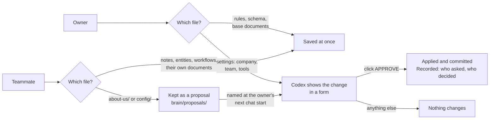
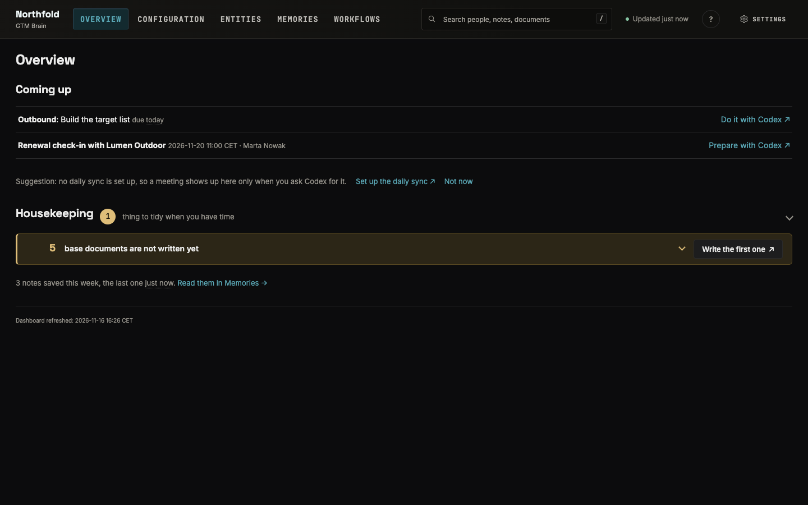
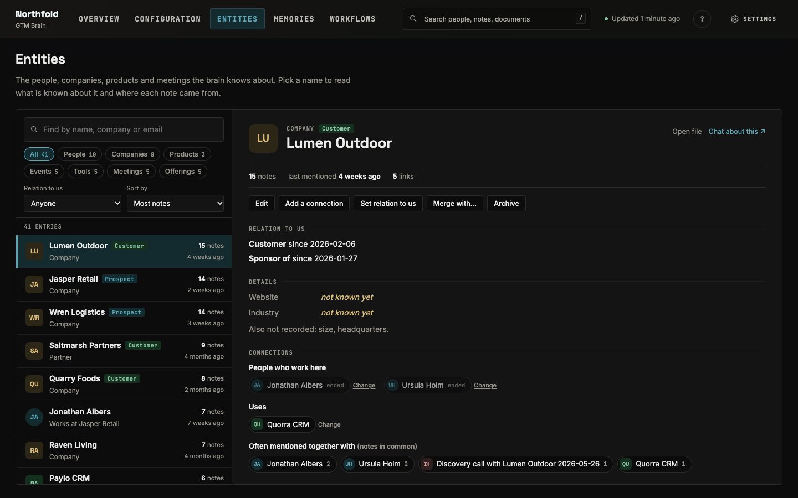
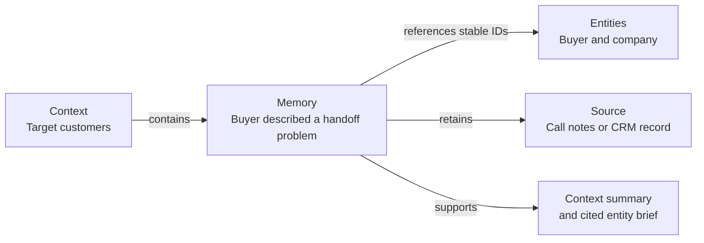
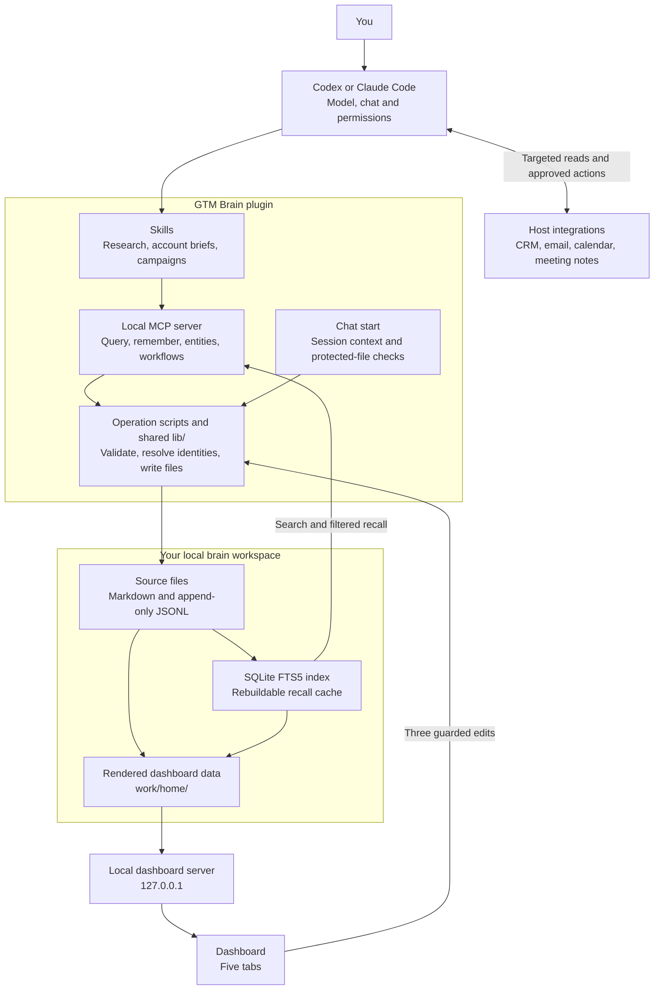
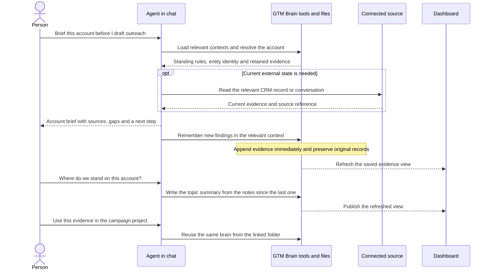

<a href="https://gtm-brain.ai/"></a>

# GTM Brain

[Website](https://gtm-brain.ai/) · [Start here](#start-here) · [Install](#install-in-codex) · [Configure](#configure-your-brain) · [Put it to work](#put-it-to-work) · [Dashboard](#the-dashboard) · [The four parts](#the-four-parts-of-a-brain) · [Architecture](#how-it-fits-together) · [Team](#working-as-a-team) · [Skills](#shipped-skills)

**For GTM engineers building research, account and campaign workflows in Codex.**

A new chat should not mean pasting your ICP again, hunting down the last customer conversation,
or reconstructing where a playbook stopped. GTM Brain keeps your ICP, offer, customer evidence
and playbook progress in local files that your agent can use across chats and linked projects.

It installs as the **`gtm-brain` plugin**. Open source under [MIT](LICENSE).
[Codex](#install-in-codex) is the primary host; [Claude Code support is in beta](#claude-code-beta).

## Start here

**New to GTM Brain**

1. Install it: [Install in Codex](#install-in-codex), one message to Codex.
2. Open a new Codex chat in an empty folder and send `/gtmb-start`. It creates the brain, asks
   about your business and connects your tools.
3. Work as usual. Say what happened ("just got off a call with ..."), ask what you need
   ("brief me on Acme", "what should I focus on this week?"), and say "open the dashboard" to
   see what the brain holds.
4. Shape it with the two commands that matter most: `/gtmb-rules` (what Codex saves and asks,
   where files go) and `/gtmb-schema` (what is kept about each person and company).

**Already using it (0.35 or earlier)**

1. Everyone on the team says "update GTM Brain" in Codex, then quits and reopens Codex.
2. Start a new chat in the brain folder and read the first reply: it says what was refreshed.
3. The skills are now `/gtmb-<name>` (they were `/gtm-brain-<name>`). An old name still works:
   Codex runs the new skill and tells you its name. If your brain's own files still use old
   names, Codex offers once to update them.
4. If the reply says the brain can be upgraded, the owner says "upgrade the brain". Only after
   everyone has updated: a teammate on an older version cannot use an upgraded brain.

Details: [Updating and upgrading](#updating-and-upgrading).

**How the brain works**

![The brain in one picture. Configuration, on the left, says what is allowed: it sets the fields and kinds of entities and checks every save into memories, and it changes only when you edit the file or approve a change Codex proposes. Entities are who and what the memories are about; names resolve and links derive from the memories. Codex, where you talk, is the only thing that reads your tools, reads the brain and saves into it. Notes and entities keep a link back to their source in your tools. Workflows, underneath, run through Codex under the rules and save each step as a note.](diagrams/brain-in-one-picture.svg)

Read it left to right. **Configuration** says what is allowed; it shapes the entities and checks
every save, and it changes only two ways (red): you ask in chat and approve what Codex proposes,
or you edit the file. **Memories** are what happened and **entities** are who and what they are
about. **Codex** is where you talk, and the only thing that reads your tools, reads the brain
and saves into it. **Your tools** keep the raw material; a dashed line is the link a note or an
entity keeps back to its original. **Workflows** are the part that acts: they run through
Codex, under the rules, and leave each step as a note.

- **It is a folder of plain files in git on your computer.** Nothing is stored anywhere else.
- **You talk, Codex saves.** What happened, was decided or is open becomes a dated note with
  its source. Notes are never edited; a correction replaces the old note and keeps it. Codex
  never guesses who someone is: it saves the note and asks.
- **People, companies and products are linked across notes,** with their relationships and
  history (who worked where, who is a customer).
- **Your base documents steer the work:** strategy, ideal customer profile, tone of voice,
  design system. Codex reads them before the work they apply to.
- **Your rules and schema decide** what Codex saves and asks, where files go, and what is kept
  about each person and company. The owner's change there is saved at once; a teammate's
  waits for the owner.
- **The dashboard shows the same files:** what needs you, housekeeping, entities, notes,
  workflows and configuration. Documents, entities and notes can be edited there.

More: [The four parts of a brain](#the-four-parts-of-a-brain) · [The folders of a brain](#what-is-stored-on-disk) · [How GTM Brain works](#how-gtm-brain-works) · [How a brain works](plugins/gtm-brain/MANUAL.md).

**Configure it:** one table of commands in [Configure your brain](#configure-your-brain).

## Install in Codex

Already using the previous plugin? Follow the [rename migration](MIGRATING.md) to keep your existing brain and switch installations safely.

Coming from 0.34? [What is new in 0.35 and how to update](RELEASE-0.35.md).

Requires the **Codex desktop app** and **Node 22.16+ (22.x) or Node 24+**. The guided installer checks your environment.

Open a new Codex chat and send:

```text
Read https://github.com/gtm-week/gtm-brain/blob/main/INSTALL.md and follow it exactly. Read nothing else in that repository.
```

Follow the setup and permission prompts. Codex installs the plugin, opens your working folder,
and guides you through your business context and tool connections. No GitHub invitation or
sign-in is required to download the plugin.

[First-use walkthrough](ONBOARDING.md) · [Everyday guide](GUIDE.md) · [Manual installation](#manual-installation)

## Configure your brain

Type a command in a Codex chat opened in the brain's folder, or say the sentence beside it.
Every skill is `/gtmb-<name>`.

**First: rules and schema.** These two decide how the brain behaves for everyone on the team.

| To change | Command | Or say |
| --- | --- | --- |
| Rules: what Codex saves, what it asks, where files go, when it reads a live tool | `/gtmb-rules` | "add a rule: ...", "from now on ...", "speaker graphics go in speakers/" |
| Schema: the fields kept per kind, the kinds and subtypes, the relationship types | `/gtmb-schema` | "every company must have a budget owner", "track venues" |

**Then: setup and the base documents.**

| To set up or change | Command | Or say |
| --- | --- | --- |
| Create the brain in a folder | `/gtmb-start` | |
| Company, team, tools, settings; connecting tools; sharing the brain | `/gtmb-configure` | "connect my tools", "push this brain to my GitHub" |
| Strategy | `/gtmb-strategy` | "run the strategic intake" |
| Ideal customer profile | `/gtmb-define-icp` | "define our ICP" |
| Tone of voice | `/gtmb-voice` | "draft our voice" |
| Design system | `/gtmb-design-system` | "build our design system" |
| A base document of your own | | "add pricing as a base file" |

**As you need them.**

| To do | Command | Or say |
| --- | --- | --- |
| A process with steps | `/gtmb-workflow` | "start the outbound workflow", "make a playbook for ..." |
| Your team's own skill | `/gtmb-skill` | "make this a skill" |
| A project: a folder plus a tag | `/gtmb-project` | "create a project for the Berlin event", "link this folder" |
| A tool | `/gtmb-clay-setup`, `/gtmb-zynt-setup`, `/gtmb-freckle-setup`, `/gtmb-woodpecker-setup`, `/gtmb-surfer-setup`, `/gtmb-heyreach-setup` | "Set up Clay for me" |
| An action you repeat in your own tool | | "propose an interaction for moving a deal in HubSpot" |
| What you owe: questions, follow-ups, proposals | `/gtmb-todo` | "what is waiting on me" |
| Tidy names and gaps, one at a time | | "let's do housekeeping" |
| The latest from connected tools | `/gtmb-sync` | "catch up", "sync every morning" |
| Who approved what | | "show the approvals" |
| Update the plugin, upgrade the brain | `/gtmb-configure` | "update GTM Brain", "upgrade the brain" |

Who can change what:



Three things to know:

- The owner's change to rules, schema or a base document is saved at once and recorded. The
  APPROVE form is only for settings (company, team, tools), a new interaction and a teammate's
  proposal.
- APPROVE is a click in the form Codex shows. Typing APPROVE, "ok" or "yes" in chat changes
  nothing. The owner can also Decline a proposal or leave it for later.
- A teammate's change under `about-us/` or `config/` is never lost: it waits as a proposal for
  the owner. More in [Working as a team](#working-as-a-team).

The whole list, with what each change does, is in
[How a brain works: Changing how it works](plugins/gtm-brain/MANUAL.md#changing-how-it-works).
Until 0.35 the skills were named `/gtm-brain-<name>`; see
[Updating and upgrading](#updating-and-upgrading).

## The four parts of a brain

The picture under [Start here](#start-here) in words: four parts, with Codex and your tools
around them.

| Part | What it is | On disk | Dashboard tab | Changed with |
| --- | --- | --- | --- | --- |
| [Configuration](#configuration) | What is allowed and what the work must follow: rules, schema, settings, base documents | `config/`, `about-us/` | Configuration | `/gtmb-rules`, `/gtmb-schema`, `/gtmb-configure`, the document commands |
| [Entities](#entities) | Who and what the notes are about: people, companies, products, events | `brain/entities/<kind>/` | Entities | what you say in chat, or the Entities tab |
| [Memories](#memories) | What happened, was decided or is open: dated notes, grouped by topic | `brain/contexts/<topic>/` | Memories | what you say in chat, or the Memories tab |
| [Workflows](#workflows) | The part that acts: processes with steps, gates and a trigger | `workflows/` | Workflows | `/gtmb-workflow` |

How the parts act on each other:

1. **Configuration shapes the entities.** The schema sets the kinds, their fields and the
   relationship types.
2. **Configuration checks every save.** A check rule refuses a note that breaks it; only a
   relationship type the schema lists is saved as a relationship.
3. **Memories feed the entities.** Names in a note resolve to entities; an entity's fields,
   relationships and relation to us are worked out from the notes, each with its citation.
4. **Codex is the only reader and writer.** It reads your tools, reads the brain and saves into it.
5. **Notes and entities link back** to the record they came from in your tools.
6. **Workflows run through Codex, under the rules,** and leave each step as a note. A saved note
   can in turn start a workflow.

### Configuration

Four things, read at the start of every chat.

| File | What it holds | Change it with |
| --- | --- | --- |
| `config/rules.md` | Three parts: Where things go, Ask the source, Our rules | `/gtmb-rules`, or edit the file |
| `config/schema.md` | The fields per kind, organization subtypes, relationship types | `/gtmb-schema`, or edit the file |
| `config/settings.yaml` | Company and one-liner, owner, team (handles and emails), tools, settings | `/gtmb-configure`; applies on the owner's APPROVE |
| `about-us/*.md` | Base documents: strategy, ICP, voice, market, design system, and yours | their commands, "add pricing as a base file", or Edit in the dashboard |

#### Rules

`config/rules.md`: the team's rules, shared through git and followed over GTM
Brain's defaults. A change applies from the next chat; an update never overwrites a file you edited.

- **Where things go:** a table of where each kind of file lands. Codex files everything by it
  and names the row it used; when no row fits it asks and offers a new row. Ask "why is this
  here?" about any file. Shipped rows include: files over 25 MB go to the shared drive,
  deliverables go inside their project, names are lowercase with hyphens.
- **Ask the source:** when Codex reads the live tool instead of a saved note. Deal stage: CRM,
  after 1 day. Meeting times: calendar, always. Latest email in a thread: email, always. Edit
  the rows ("1 day", "2 weeks", "always ask", "no limit"). A row counts only while that tool is
  connected; otherwise the brain answers and says how old its note is.
- **Our rules:** one line per rule, in your words, for what Codex saves and asks. On your yes
  Codex files a rule with a tag line (`> applies to: organization · when: saving customer
  status · check`). A check rule such as "Never call a company a customer before a signed
  contract" then refuses a save that breaks it and quotes the rule. Four forms can be checked:
  a quoted word that must not appear, a status only before or without a fact, a note never
  without a source, a schema field always included. Any other rule is shown as guidance.
- **What a rule cannot do:** start work ("whenever X, do Y" is offered as a workflow), switch
  off APPROVE or the protected files, or move files that already exist.

#### Schema

`config/schema.md`: what the brain keeps about each kind.

- **Kinds.** Seven ship: person, organization, product, offering (what we sell), event, tool,
  meeting. Add your own with a `## <Kind>` section and a field table ("track venues"). A
  project is a tag, never a kind.
- **Fields.** Each kind has a table of fields and marks the required ones: a person's role, an
  organization's website and industry, a product's category, an event's date.
- **Values are never typed into the schema.** Codex fills them on the entity page from your
  notes, each with its citation, and never invents one. A required field nobody has stated
  shows as a gap with the question to ask.
- **Subtypes** exist only on organizations (company, team, investor, partner, community) and
  can have fields of their own.
- **Relationships.** The table lists the types Codex may save: `works_at`, `reports_to`,
  `partner_of`, `investor_in`, `uses`, `speaker_at`, `attended`, `integrates_with`,
  `customer_of`. A type marked One at a time ends the previous one when a new one starts, so
  "Anna joined Acme" also ends her job at Northwind. An unlisted type is saved as a plain note
  with an offer to add it.

#### Documents

Base documents and your other documents. Detail: [DOCUMENTS.md](DOCUMENTS.md).

- A document's header says what work it applies to (copy, outreach, landing pages, planning)
  and whether it is a draft or approved. Every chat opens with one line listing the documents.
- Before work of a listed kind Codex reads the matching document in full, follows it and says
  which one. A draft is the best available guidance, and Codex says so; only your word approves
  it ("approve the strategy"). A starter nobody has written yet shows as not filled.
- **Base documents** live in `about-us/` and are the owner's. Add your own with "add pricing as
  a base file" (starters: pricing, positioning, competitors, objections).
- **Any other document** stays in a folder your team names (`talks/talk-draft.md`) and anyone
  on the team changes it. A Markdown file you dropped in is not read before work until you say
  "add pricing.md as a document".
- A document's files sit in a folder of the same name (`strategy/deck.pdf`). The design system
  is also a page, `design-system.html`: one self-contained file shown on the dashboard's Visual
  tab and kept in step with `design-system.md`.

#### Settings

`config/settings.yaml` replaces `brain/admin.md`. Beside company, owner, team and tools it holds:
dashboard timing (`dashboard: always` or `on-demand`), the save reminder (`save_nudge: off`),
workflows on or off (`workflows: off`) and where big files go (`big_files: google-drive` or
`local`). A change is shown first and applies only when the owner clicks APPROVE.

### Entities

One page per person, organization, product, offering, event, tool or meeting, at
`brain/entities/<kind>/<name>-<short id>.md`. Facts stay in the notes; the page is the identity
and a cited brief built from them.

| What | How it works | Say |
| --- | --- | --- |
| Identity | One id through renames. An alias adds a name and never merges two records | "Ann is Anna Lind", "Acme is a company" |
| Names | Never guessed. A first name alone is saved as written and you are asked "Who is Anna?". Look-alike names are flagged "may be the same" and merged only on your yes; a "different" answer is kept, so the pair is not asked again | "who is Anna Lind" |
| Merge and archive | A merge is shown first, applied on your yes and can be undone; the old name still finds them. An archived entity keeps its notes | "Acme and Acme Inc are the same company" |
| Fields | Filled from your notes, each value with its citation. A required field nobody has stated is a gap with the question to ask | "check the brain against its rules" |
| Relationships | A note naming both ends and a type from the schema. Each is dated: started, changed, ended. Ended links stay as history. What you said beats what a tool says | "Anna left Northwind and joined Acme", "where did Anna work in June?" |
| Relation to us | Team, customer, partner, investor, prospect or other, worked out from your notes | "show the customers' VPs of Sales" |
| Meetings | A meeting is saved as what came of it and gets a page listing those notes and who attended. The transcript stays in its tool, linked from the page | "just got off a call with Acme: ..." |

Each kind's folder has a generated `index.md`: never edit it. A page's own Markdown may be
edited by hand; say "save" afterwards. Renames, merges and kind changes are shown under History
on the page. Detail: [How a brain works: Saving](plugins/gtm-brain/MANUAL.md#saving-what-you-say-what-it-keeps).

### Memories

A memory is a note: one dated line in a topic's `memories.jsonl`, never edited afterwards.

- **What a note is.** A note, a decision or a question, with its author, date, the people and
  companies it names, tags (a project is the tag `project:<slug>`) and its source: the exact
  link to the record. The chat it came from is always kept.
- **Saving.** Say it once, in a plain sentence; you do not need to say "remember". A repeat is
  answered "already kept", a changed date or amount becomes a correction, and "we had a call"
  alone is not saved, only what came of it.
- **Correcting.** "Correct ..." or "actually it is the 19th" saves a replacement. "Forget
  that ..." withdraws a note. The old note leaves every answer and view but stays in the file
  and in git; a commit that changes an existing line is refused.
- **Topics** (contexts). Notes are grouped by topic: Our company, Strategy, Market, Target
  customers, Our offer, and yours. A note lands where its meaning fits, answers search every
  topic, and a new topic is made only on your yes. Rename, archive or fork one in chat.
- **Personal topic.** `brain/contexts/personal-<handle>/` holds one person's role and working
  preferences; setup makes one for whoever set the brain up. It shapes their own chats, never
  the team's.
- **A topic's cover** (`context.md`) has three parts: your standing rule ("change the rule of
  Our offer to ..."), a short summary where every sentence cites its notes, and working
  guidance Codex learned there.
- **Summaries are written when you ask:** load the topic, "where do we stand on pricing?" or
  "update the summary". The summary is written in that chat and kept until new notes arrive.
  Nothing runs after a save. Answers always search the notes, so a summary that is behind
  never makes an answer wrong. A weekly Codex Scheduled task is optional.
- **Open questions.** The brain keeps its questions ("Who is Anna?", "who signs for Acme?")
  until you answer. Ask "what is open?"; your answer is saved as the note that closes the question.
- **Chat capture.** What you decided in a chat but never saved is picked up by the nightly run
  and saved as notes tagged `captured`, each resting on an exact sentence. The next chat lists
  them and "undo captured" withdraws them.
- **Asking.** Ask in your own words ("what did Anna want last week?", "decisions in October").
  One search over every topic returns the notes with date and source and the card of whoever
  you named, or says plainly that nothing was found.

Detail: [Contexts](plugins/gtm-brain/MANUAL.md#contexts) ·
[Summaries](plugins/gtm-brain/MANUAL.md#summaries) ·
[Chat capture](plugins/gtm-brain/MANUAL.md#chat-capture).

### Workflows

A workflow is a file in `workflows/`: skills in sequence, with a gate between steps. A playbook
is a workflow. Every new brain starts with two drafts, `outbound.md` and
`ads-then-outbound.md`: edit them, or say "make a playbook for ..." to write your own.

The file starts with a header, then three headings: `## Before starting`, `## Steps`, `## Learn`.

```yaml
type: workflow
status: draft                      # draft, active or paused
trigger: note about organization   # or manual, or a schedule: every Monday 09:00
reads: ["kind:organization", "tool:crm"]
writes: ["tool:email"]
```

```text
1. **Title** (tool: crm) (skill: gtmb-deepdive). What to do. Milestone: a note tagged brief-done. Gate: after 3 days.
```

- **Status.** A draft runs only when a person starts it, an active one also starts from its
  trigger, a paused one offers nothing.

- **Steps.** A step may name a tool category and a skill. It ends on a milestone the brain can
  see (a tagged note, a link, a filled field, a written document) and may wait at a gate
  (`after 14 days`, `on 2026-12-01`, `when ...`). When the milestone appears, the brain records
  the step done and opens the next. The rules bind every step.
- **Switching one on.** Say "check the outbound workflow" (it validates the file and dry-runs
  one real example, writing nothing), then "switch it on". From then on its trigger offers a
  run at the start of your next chat, and it starts only when you say yes.
- **Nothing runs silently** or reaches you outside Codex. A due step or a fired trigger shows
  in the chat's opening lines, in the todo list and on the dashboard.
- **Running one.** "start the outbound workflow", "where is the campaign", "next step", "skip
  this step", "pause the run", "cancel the run", "step 3 failed: ...". Each is kept as a note
  with your reason. "which workflows are running" lists every run.
- **Limits.** Three open runs per workflow, five automatic steps a run a day, and
  `workflows: off` in the settings stops them all.

Detail: [WORKFLOWS.md](WORKFLOWS.md).

### Skills, projects and interactions

Three things sit beside the four parts and are easy to confuse with a workflow.

| Thing | What it is | Where it lives |
| --- | --- | --- |
| Shipped skill | One sitting of work. Twenty-six ship with the plugin as `/gtmb-<name>`: [the list](#shipped-skills). Not yours to edit | the plugin |
| Your team's skill | The same, made by you. Shared with the brain and kept through updates | `.agents/skills/gtmb-<name>/` |
| Workflow | Skills chained into steps, with gates and a trigger | `workflows/` |
| Interaction | One approved action in your own tool, done and recorded the same way every time | `brain/ontology.ossie.json` |
| Project | A folder for files plus a tag on notes; never a second brain | `projects/<slug>/`, or a folder linked from elsewhere |

- **Your team's skills.** Say "make this a skill" after a piece of work. Codex shows the draft
  and saves it on your yes. Teammates get it with the brain, and it appears as `/gtmb-<name>`
  after you quit and reopen Codex. "install the skill <owner>/<repo> at <path>" brings one in
  from GitHub; "list my skills" and "remove the skill ..." manage them. Detail:
  [USER-SKILLS.md](USER-SKILLS.md).
- **Interactions.** Say "propose an interaction for moving a deal in HubSpot". After your
  APPROVE it is kept in `brain/ontology.ossie.json`. Each time it runs, Codex does it in the
  tool first and saves the note only when the tool confirms; a failed write is saved as a failure.
- **Projects.** "create a project for the Berlin event" makes `projects/berlin-event/` in the
  brain. "link this folder" connects a folder where it already lives, such as a code
  repository. People and companies stay shared, a note goes to the topic its meaning fits and
  carries `project:berlin-event`, and "unlink this project" removes only the link. One folder
  belongs to one brain; nested projects are refused. Detail:
  [One brain, many projects](plugins/gtm-brain/MANUAL.md#one-brain-many-projects).

## Put it to work

### In every chat

Every new chat starts by itself. On its first GTM Brain call it pulls teammates' changes,
reloads the topics you had open, says who you are saving as, and tells you in its first reply
what needs you: open questions, a workflow step due, a failed push, an update or an upgrade on
offer. Every offer waits for your yes.

| Say | What happens |
| --- | --- |
| "we decided no discount for Bergstrom" | saved as a decision, with its source |
| "open question: who signs for Acme?" | kept as a question until you answer it |
| "actually the meeting is on the 19th" | a correction replaces the old note and keeps it |
| "forget that ..." | the note is withdrawn from every answer and view |
| "Ann is Anna Lind" | one person, two names |
| "why did you add Anna?" | the first note about her: when, by whom, from where |
| "brief me on Acme", "what do we know about pricing?" | an answer from the notes, with dates and sources |
| "what is open?", "what is waiting on me" | the open questions; what you owe |
| "open the dashboard" | the page in the [dashboard](#the-dashboard) section |

Codex never guesses a first name or an unclear date: it saves the note and asks. When it needs
a decision it asks one question at a time, in a form with two to four choices and a box for
your own words. Closing the form is not an answer, and a choice never replaces APPROVE.

Six rules hold in every chat, whatever you configure:

1. Save each outcome at once, one note per outcome, with its source.
2. Read the brain before answering about the company, a customer or a deal, and say how old a
   stored fact is. Never invent.
3. Fewest tool calls, short replies.
4. A list of things to tidy is taken one item at a time, with you.
5. Nothing about a person or company is looked up on the web unless you ask for exactly that.
6. Company settings and interactions change only through APPROVE.

More phrases: [Everyday guide](GUIDE.md).

The requests below are examples, not preloaded data. The answers depend on the context you
provide and the tools you connect.

### Before an account meeting

> Brief me on this account. What did they ask for, who is involved, and what is still unanswered?

Get a one-page brief with a dated timeline, source links, open questions and a proposed next
step. The agent checks the relevant connected sources when the answer needs current information.

### Before entering a new segment

> Research this segment against our ICP and offer. What are the buying pains, who buys, and what evidence supports the fit?

Get a sourced market diagnosis that uses your existing strategy and customer evidence.
Findings, hypotheses and gaps stay separate, so a plausible market story does not pass as proof.

### When a campaign spans more than one chat

> Turn this outbound process into a playbook with steps and approval gates. Then show me where the current run stands.

Keep the process and each run's progress together. The agent can carry out a step through a
connected tool with the required permission, or record a step you completed yourself.
Playbooks track work; execution happens in chat, with human decisions where the process requires them.

### Before increasing acquisition spend

> Compare CAC, LTV and payback for paid search, outbound and referrals. Show the inputs and assumptions. Where should we push, fix, stop or measure?

Get a unit-economics review with comparable periods, explicit assumptions and missing data
called out. The review makes a recommendation; budget and campaign changes remain separate actions.

### After a useful process becomes repeatable

> Make this research process a skill I can reuse in our other projects.

Keep your own skills in the brain and use them from linked project folders. Plugin updates
preserve them.

The research skills end in something you keep: deep dive a one-page brief, market desk research
a sourced report with a positioning map, unit economics a PUSH, FIX, STOP or MEASURE decision
note, define ICP and strategy the `icp.md` and `strategy.md` drafts. All twenty-six skills are
listed under [Shipped skills](#shipped-skills) and in the [command reference](COMMANDS.md).

## What it solves

| The work you keep repeating | What GTM Brain does |
| --- | --- |
| **Re-explaining who you sell to and why you win.** Every research or campaign chat needs the same ICP, offer, proof and messaging rules. | Keeps those as standing documents and shared context. Linked project folders use the same brain, so a new project can reuse what you have already established. |
| **Reconstructing an account from CRM records, emails and call notes.** The useful detail is scattered, and yesterday's summary may miss today's change. | Builds a sourced account brief from retained evidence and targeted reads of connected tools: where things stand, who is involved, what happened and what remains unanswered. |
| **Losing the state of a multi-step GTM playbook.** The prompt is saved, but which step ran, what is due and what needs approval are not. | Keeps reusable playbooks (workflows) with tracked runs, steps, dates and approval gates. Resume a run in chat with its recorded progress. |
| **Getting a GTM recommendation you cannot check.** Market claims lack evidence; CAC and LTV use incompatible inputs. | Runs sourced market research and unit-economics reviews that expose evidence, assumptions and missing inputs. You can inspect the basis for the conclusion. |

## The dashboard

Say "open the dashboard". It shows what the brain holds, from the same files Codex reads. Most
work happens in chat; the page is for reading, plus three kinds of edit.

| Tab | Shows | What you can do there |
| --- | --- | --- |
| Overview | What needs you, what is coming up, what to tidy | Press a card's button: it prepares the work in Codex |
| Configuration | Base documents, rules, schema, settings | Edit a document. Rules, schema and settings are read here and changed in chat |
| Entities | People, companies and the other kinds, with relationships and history | Add an entity; edit its name, aliases, emails and kind; fill its fields; add or end a connection; set its relation to us; merge two after a preview; archive one |
| Memories | The notes by topic, with their sources | On a note's menu: Correct this, This was wrong, Move to another topic, Change what kind it is, Answered |
| Workflows | Workflows, their runs, and your team's skills | Read; "Chat about this" prepares a message |

- **One search box** at the top finds notes, people, tools and topics. **More** holds Explore
  and Help.
- **Overview** has three groups. Red cards need a decision: open questions, a change waiting
  for the owner, a broken tool connection, a failed summary, a plugin update. Coming up lists
  due workflow steps and meetings in the next 7 days. Orange Housekeeping lists look-alike
  names, first-name-only people, duplicate notes, unwritten base documents and missing required
  fields.
- **Edits are saved the way chat saves them,** through the same checked write path and under
  your name. A correction adds a note and never rewrites one. A teammate's save of a base
  document becomes a proposal for the owner, and a document that changed since you opened it is
  not overwritten.
- **Buttons prepare, you send.** A button such as "Answer with Codex" puts a prepared message
  into the Codex chat you already have open; nothing happens until you press Send.
- **What it never does:** run a campaign, a tool or a Codex job.

**Actual GTM Brain dashboard, populated with fictional demo data.** These are captures
of the shipped app, not mockups. No customer or private workspace data is shown.





## How GTM Brain works

GTM Brain is a plugin that gives your agent a persistent, structured workspace for GTM work.
The host provides the model, chat, permissions and connected tools. GTM Brain provides the
skills, memory operations, local files and dashboard. There is no separate hosted GTM Brain
backend to provision.

### Three formal objects

| Object | What it holds | Where it lives |
| --- | --- | --- |
| **Context** (a topic) | Your standing rule, a cited summary, learned working guidance, mentioned entities, tools and related contexts. Examples: Target customers, Our offer, Strategy. | `brain/contexts/<slug>/context.md` |
| **Memory** (a note) | One dated note, decision or question, with its authors, sources, the people and companies it names, tools and tags. | `brain/contexts/<slug>/memories.jsonl` |
| **Entity** | One page per person, organization, product, offering, event, tool or meeting: name, aliases, contacts, external references and a cited brief across contexts. Add your own kind as a section in `config/schema.md`. | `brain/entities/<kind>/<name>-<short id>.md` |



The context answers **what topic are we working on?** The memory answers **what happened,
who said it, and where is the evidence?** The entity answers **which person, company or product
is this, across all our work?** A company does not automatically become a separate context.
Customer, partner and employer are relationships supported by memories, not extra identity types.

Alongside these objects: the settings in `config/settings.yaml`, the documents, the workflows
and the projects, each described under [The four parts of a brain](#the-four-parts-of-a-brain).

### How it fits together



**Skills coordinate the work.** They tell the agent how to research, brief an account, review
unit economics or advance a playbook. Detailed procedures are loaded when needed. The agent
calls small MCP operations; operation scripts use shared library readers, validators and writers.

**Files retain the evidence.** Memory writes append to JSONL immediately. Corrections add a
new record with `supersedes`; withdrawals and answered questions use `retracts`. Historical
records remain intact. Entity identities link those records across contexts without copying
the underlying facts into another database of truth.

**The index makes recall practical.** A local SQLite FTS5 index supports keyword search,
alias expansion, exact filters and read-only SQL for counts, joins and dates. It is a rebuildable
cache under `work/`; Markdown and JSONL remain authoritative.

**The dashboard renders the same state.** A Node renderer builds dashboard data from the brain
and index. A local server serves the prebuilt React interface and revision events so open views
can update. Its only writes are the three edits described under [The dashboard](#the-dashboard),
each one call of the script the chat tools run.

### From a call note to the next campaign



A new chat restores the working context on its first GTM Brain call. Loading a context brings in
its standing rule, summary, working guidance and recent memories. It does not load every
transcript or every account into the prompt. Broader recall searches across the brain when needed.

Notes are saved immediately. A summary is written when you ask about its topic, never by a run
after a save; the chat says how old it is ("as of 12 Nov, 4 newer notes"). A summary you edited
by hand is paused until you review the edit in chat. Refreshing a summary is not a live check
of its sources.

### What is stored on disk

A brain is one folder. Each part of the picture above has its place in it, and the dashboard's
tabs show the same parts.

```text
your-brain/
  about-us/                         Base documents: what the work must follow
    strategy.md  icp.md  voice.md  market.md
    design-system.md  design-system.html
  config/                           How the brain behaves; only the owner changes it
    rules.md                        Where things go, Ask the source, Our rules
    schema.md                       Fields per kind, organization subtypes, relationship types
    settings.yaml                   Company, owner, team, tools and settings
  brain/
    entities/                       One page per person, company, product, event, tool, meeting
      people/  organizations/  products/  events/  tools/  meetings/  offerings/
    contexts/                       Memories, grouped by topic
      company/  icp/  market/  offer/  strategy/  personal-<handle>/
        memories.jsonl              The notes: one per line, never edited
        context.md                  The topic's standing rule, summary and working guidance
    proposals/                      A teammate's change to about-us/ or config/, waiting for the owner
    ontology.ossie.json             Your company's own interactions, once one is approved
  workflows/                        Processes with steps; a run's state is kept as notes
  projects/                         Working folders for an event, a campaign, a client
  .agents/skills/                   Skills your team made
  AGENTS.md  CLAUDE.md  README.md   Written by GTM Brain and refreshed on update
  work/                             This computer only, not in git: search index, dashboard, caches
```

What you may edit by hand:

| File | A hand edit |
| --- | --- |
| Entity pages, your own documents, workflows | Kept. Say "save" afterwards |
| `about-us/`, `config/rules.md`, `config/schema.md` | The owner's is kept and recorded. A teammate's is put back and kept as a proposal |
| `config/settings.yaml` | Change it through APPROVE. A file deleted or left without a company, owner or team is put back |
| `memories.jsonl`, `brain/ontology.ossie.json` | Put back; your version is kept in `work/manual-edits/protected/`. Correct a note in chat instead |
| `AGENTS.md`, `CLAUDE.md` | Rewritten on update. Your own lines stay under "This brain's own additions" |
| A generated `index.md` | Rewritten with the pages |

A brain made before 0.35 keeps the base documents and `RULES.md`, `SCHEMA.md` at the top and its
settings in `brain/admin.md` until its owner says "upgrade the brain"
([Updating and upgrading](#updating-and-upgrading)).

The plugin's source and your brain are separate folders. Updating the plugin does not replace
your memories, documents or custom skills. Every change is committed to the brain's own git
history at once. Files over 25 MB never go into git: they go to the shared drive or a folder
outside git, and the note keeps the link.

### Sources, permissions and boundaries

CRM, email, calendar and meeting sources come through the host's connected integrations,
with their own accounts and permissions. GTM Brain retains useful findings and exact source
references; it does not mirror every record. Broad source sync runs on request or on an
approved schedule. A targeted live read follows the Ask the source table in `config/rules.md`.

Customer evidence can exist without a CRM record. Meeting records distinguish scheduled events
from evidence that a conversation happened, and distinguish available notes or transcripts
from missing content. Neither a cached summary nor a calendar invitation proves the current
state of an account.

External sends, account changes and other actions go through the relevant integration and its
permission flow. A workflow records prerequisites, step progress, dates and gates; its tracker
does not perform the step by itself. The agent carries out authorized work through connected
tools and then records what happened.

Relevant content is processed by your AI host and connected services. Local file ownership
does not mean offline AI processing.

## Tools and sync

Naming a tool in the settings does not connect it. A tool has three states:

| State | What it means | How it gets there |
| --- | --- | --- |
| Declared | Named in `config/settings.yaml`, shared with the team | a settings change, through APPROVE |
| Installed | Its connector is in your Codex, signed in by you | "connect my tools": Codex checks each tool and installs the ones you pick |
| Tested | A small read returned data (one deal, three subjects, titles only) | the read test; it never writes to a tool and is never saved as knowledge |

- **Each teammate does this once.** Sign-in is yours and the result stays on your computer
  (`work/tools.json`). Codex suggests the floor: email, calendar, CRM. A tool you decline is
  not proposed again, and one with no official plugin works by export or paste.
- **Every chat opens with the tools' status.** GTM Brain cannot see other connectors' calls.
- **Sync.** "catch up" reads what changed in each connected, tested tool since its last sync
  (the last 7 days the first time) and saves what matters with a link to the source. It never
  writes to a tool and never saves a to-do or a plan.
- **Daily sync.** "sync every morning" schedules it in Codex, 09:00 by default. It reads only
  the approved sources, asks nothing and sends nothing, and it runs only while your computer
  is on and Codex is running. The alternatives are "sync manually" and "summaries only".
- **Live reads.** The Ask the source table in `config/rules.md` says which questions go to a
  tool and how old a saved note may be ([Configuration](#configuration)).
- **Tool setup skills.** Say "Set up Clay for me" (or Freckle, Woodpecker, Surfer, HeyReach;
  for ZYNT, paste ZYNT's own setup prompt). Each connects on your yes, never keeps a key, does
  one first job from your ICP and voice, asks again before anything that spends credits, and
  never sends, publishes or starts a campaign.

Detail: [command reference](COMMANDS.md).

## Working as a team

A brain is shared through git. Nothing else is needed.

- **Share it.** Say "push this brain to my GitHub" (needs `gh auth login` and
  `gh auth setup-git` once). It creates a private repository; from then on every save is
  pushed and every chat start pulls. Teammates clone it, open the folder in Codex and install
  the same plugin version.
- **When git gets in the way.** A failed push or a conflicting teammate change is said at the
  next chat start. Notes stay local and the next save retries; nothing is lost. Two chats can
  write at once: notes are appended, never edited, so they merge line by line.
- **Who you are saving as.** Each computer saves under one team member's name, taken from the
  folder's git email or asked once. The chat start says it: "saving as: marta".
- **The owner** is the person on the `owner` line of `config/settings.yaml`: first, whoever
  ran setup. Only the current owner can hand it over.
- **Owner-only files.** Only the owner changes `about-us/` and `config/`. A teammate's change
  there, by tool, dashboard or hand edit, leaves the files as they were and waits in
  `brain/proposals/`; the teammate is told "NOT APPLIED: ... is the owner's to change", and the
  owner's next chat names the proposal in one line.
- **APPROVE** is a click on APPROVE in the form Codex shows, by the owner. Typed words apply
  nothing. A proposal's form offers APPROVE, Decline or Not now. When the host cannot show the
  form, Codex gives a terminal command you run and type APPROVE in.
- **The record.** Say "show the approvals": every approved or declined change (who asked, who
  decided, which file, the commit) and the proposals still waiting.
- **How far it goes.** The owner rule is enforced by GTM Brain, not by git. A teammate with
  write access can still push such a file directly; to stop that, protect `about-us/**`,
  `config/**` and `brain/ontology.ossie.json` with a GitHub ruleset.
- **Per computer, not shared:** `work/`, tool sign-ins and big files. Sharing a brain shares
  the references to big files, not the files.

Detail: [Who can change the base files](plugins/gtm-brain/MANUAL.md#who-can-change-the-base-files).

## Updating and upgrading

Two separate steps. Updating the plugin moves nothing in your brain.

| Step | Say | What happens | Who |
| --- | --- | --- | --- |
| Update the plugin | "update GTM Brain", then quit and reopen Codex | The first reply of the next chat refreshes `AGENTS.md`, and the README, rules and schema nobody edited, with a backup in `work/upgrades/` | everyone, first |
| Upgrade the brain, move 1 | "upgrade the brain" | Asks first, then moves entity pages into a folder per kind | anyone on the team |
| Upgrade the brain, move 2 | "upgrade the brain" | Asks first, then moves base documents into `about-us/` and rules, schema and settings into `config/` | only the owner |

- **Everyone updates before the owner upgrades.** A teammate still on 0.34 loses known people
  and companies after the first move and sees "is not a brain" after the second. The fix is to
  update, never to run setup.
- **A new chat alone is not enough** after an update: quit and reopen Codex.
- **Going back.** Each move is one git commit and can be reverted; no note is touched.
- **0.36 only renames the skills** to `/gtmb-<name>`. An old name still runs. If your brain's
  own files still use old names, Codex offers once to rewrite them.
- An update on offer appears once at chat start and as a card on the dashboard's Overview.

Detail: [Updating to 0.36](plugins/gtm-brain/MANUAL.md#updating-to-036-short-skill-names) ·
[Updating to 0.35](plugins/gtm-brain/MANUAL.md#updating-to-035) · [RELEASE-0.35.md](RELEASE-0.35.md).

## Shipped skills

Ask for an outcome in ordinary language, or invoke one of the twenty-six shipped skills. A
skill is one sitting of work; for the difference from a workflow, your team's skill and an
interaction see [Skills, projects and interactions](#skills-projects-and-interactions).

| Command | Use it for |
| --- | --- |
| `/gtmb-start` | Set up the brain and continue first-use discovery. |
| `/gtmb-use-brain` | Recall evidence, save findings and resume everyday work. |
| `/gtmb-rules` | Show, add, change or remove a rule: what Codex saves and asks, where files go, when it asks the source. |
| `/gtmb-schema` | Change the fields, kinds, subtypes and relationship types the brain keeps. |
| `/gtmb-configure` | Change company, team, tools and settings through APPROVE; connect and test tools; update the plugin; share the brain. |
| `/gtmb-deepdive` | Build a one-page sourced brief on an account, person, deal or context. |
| `/gtmb-market-desk-research` | Assess a segment, buying pains, alternatives and evidence for fit; ends in a sourced report with a positioning map. |
| `/gtmb-define-icp` | Define company fit, buying roles and readiness with Chris Pawlak's interview; keep one draft ICP. |
| `/gtmb-unit-economics` | Compare CAC, LTV, payback and retention with explicit inputs and gaps; ends in PUSH, FIX, STOP or MEASURE. |
| `/gtmb-strategy` | Work through a strategic intake and maintain the strategy document. |
| `/gtmb-voice` | Draft a tone of voice: whose it is first (company, person or team), then from writing that fits, tested on one fresh piece; the company's is `voice.md`. |
| `/gtmb-zynt-setup` | Set up ZYNT buying signals from the brain when you paste ZYNT's setup prompt; ZYNT then shows in the brain's tools. |
| `/gtmb-freckle-setup` | Connect Freckle (lead enrichment) on your yes and build its first list of target companies and people from the brain; runs that spend credits ask first. |
| `/gtmb-clay-setup` | Connect Clay on your yes and find the brain's target companies and people in it (search is free); enrichment that spends credits asks first. |
| `/gtmb-woodpecker-setup` | Connect Woodpecker on your yes, see how your campaigns perform, and save one email sequence written from the brain as a draft; it never starts a campaign. |
| `/gtmb-surfer-setup` | Connect Surfer on your yes, get topics from the brain's strategy, market and call notes, and brief the first article; a full article asks first, nothing is published. |
| `/gtmb-heyreach-setup` | Connect HeyReach with your workspace's Connection URL, see how your LinkedIn campaigns do, and get a connection note and follow-ups from the brain to paste in; nothing is sent. |
| `/gtmb-workflow` | Create a workflow (a playbook), check it, switch it on, start a run and advance through its steps and gates. |
| `/gtmb-sync` | Pull what changed in connected tools and keep what matters; set up the daily sync. |
| `/gtmb-todo` | List what you owe: open questions, dated follow-ups, proposals, Slack replies; at most eight, one at a time. |
| `/gtmb-project` | Create a project in the brain or link a folder where it already lives. |
| `/gtmb-design-system` | Build our website design system from the existing brand with Brian Woloszczak and Peakout's starter. |
| `/gtmb-add-section` | Add a reusable section to the website design system. |
| `/gtmb-build-landing-page` | Build a campaign page on the shared website; stops at a local preview. |
| `/gtmb-publish-website` | Publish the shared website on Vercel: preview first, production on its own decision. |
| `/gtmb-skill` | Turn a repeated process into your team's own reusable skill. |

"Let's do housekeeping" is not `/gtmb-todo`. It lists what to settle (first names without a
surname, names that may be the same, required fields nobody stated) with the evidence, one
question at a time and only when you ask; nothing changes until you answer.

The website is one project at `projects/website` with its own git: `/gtmb-design-system`
creates it, `/gtmb-add-section` and `/gtmb-build-landing-page` add to it and stop at a local
preview, and `/gtmb-publish-website` needs your Vercel and GitHub connectors. The website
skills use Brian Woloszczak and Peakout's GTM Tech Week starter; GTM Brain bundles its pinned
source unchanged and plugin updates never rewrite your website project. See the
[preservation contract](plugins/gtm-brain/starters/web-design-system/README.md).

## What it does not do

- Copy your CRM, mail or calendar: it reads them live and keeps what happened and what you decided.
- Invent a fact, or look a person or company up on the web unasked.
- Record a write to a tool that did not happen.
- Merge names, create a topic or change company info without your yes.
- Run while the computer is off or asleep.
- See other connectors' calls.
- Work in a language other than English.
- Stop a teammate from changing files with git directly.

## Claude Code (beta)

In Claude Code, run:

```text
/plugin marketplace add gtm-week/gtm-brain
/plugin install gtm-brain@gtm-brain
```

In the Claude desktop app:

1. Choose Add marketplace and enter `https://github.com/gtm-week/gtm-brain.git`.
2. Click Sync, then install `gtm-brain`.
3. Open an empty folder, start a session and say: "Set up a company brain here."

Setup, memory, briefs, questions, linked projects and protected-file approvals are supported.
The brain works the same, with these differences:

- The dashboard is a link in your browser, and its Codex buttons do nothing there.
- There are no scheduled runs and no connector checks: a daily sync or a scheduled summary
  cannot be set up from Claude Code.
- Your team's skills live in `.claude/skills` instead of `.agents/skills`.
- A note's source names the session as `claude:<id>`; reopen it with `claude --resume <id>`.
- Updates are manual. From version 0.30.3, say "update GTM Brain" when prompted, then run
  `/reload-plugins`. On older versions, first run
  `claude plugin marketplace update gtm-brain && claude plugin update gtm-brain@gtm-brain`.
- Some skill instructions still name Codex.

## Manual installation

```bash
codex plugin marketplace add gtm-week/gtm-brain
codex plugin marketplace upgrade gtm-brain
codex plugin add gtm-brain@gtm-brain
```

The upgrade line refreshes an existing marketplace snapshot. GTM Brain has no hooks to approve.
In a new chat in an empty project folder, send "Set up GTM Brain here" or
`/gtmb-start`.

To verify the first use, ask the agent to remember a test finding, recall it in a new chat and
show the dashboard. The same record should appear in the context and on the dashboard.
The installation bundles the dashboard assets; users do not need to build the frontend.

### Moving from GTM OS

For an existing `gtm-os` installation, use the migration below instead of setting up a new brain:

```bash
migration_dir="$(mktemp -d "${TMPDIR:-/tmp}/gtm-brain-migrate.XXXXXX")"
git clone --depth 1 https://github.com/gtm-week/gtm-brain.git "$migration_dir/source"
node "$migration_dir/source/scripts/migrate-install.mjs" codex
```

For Claude Code, replace the final `codex` argument with `claude`. The helper verifies the new
installation before retiring the old plugin. Restart the host, open the **same working folder**
and ask to refresh the brain rules. Existing memories, entities and custom skills stay in place;
built-in commands now start with `/gtmb-`. Personal schedules that reference old installation
paths need updating. [MIGRATING.md](MIGRATING.md) contains the full compatibility notes.


## Source layout

For contributors. This is the plugin's repository, not a brain.

```text
plugins/gtm-brain/              everything that ships
  .codex-plugin/plugin.json     the manifest and the version; the Claude Code files are generated from it
  skills/gtmb-*/                the shipped skills, one folder each: SKILL.md and its references/
  server/                       the MCP server (server.mjs) and the dashboard server (dash.mjs)
  scripts/gtm-brain-*/          one folder per operation the server runs: remember, load, compile,
                                render, setup, approve, upgrade, ...
  lib/                          the file format and the only write path: notes, entities, documents,
                                search, owner rules, paths; Node built-ins only
  session/                      what runs at a chat's first call: the opening lines, the refresh
  ontology/                     the plugin's own tools, described once and generated as MCP tools
  policies/                     shared instruction text, copied into the marked blocks by sync-derived
  templates/                    what setup writes into a new brain; legacy/ holds every shipped rulebook
  starters/                     the website design system starter
  test/                         node --test 'plugins/gtm-brain/test/*.test.mjs'; live/ and e2e/ are benchmarks
frontend/dashboard/             dashboard frontend source and browser tests; built assets ship with the plugin
scripts/sync-derived.mjs        regenerates derived text, schemas and the Claude Code declarations
diagrams/                       the pictures and screenshots in this README
dev-install.sh  dev-reset.sh    install this checkout into Codex; wipe and reinstall a test brain
```

The plugin ships from `gtm-week/gtm-brain`, branch `main`. Describe a feature once, in its owning
document, and link to it from the others. More in [CONTRIBUTING.md](CONTRIBUTING.md).

## Before pushing to main

`./dev-install.sh` points git at [.githooks/](.githooks/). Before a push to `main`, the pre-push
hook runs the test suite, then [the harness bench](plugins/gtm-brain/test/live/harness-bench.mjs)
when the push changes what ships. The bench runs three tasks (a coding fix, a logic puzzle, a
connector question) through `codex exec` without the plugin, with it in an ordinary folder and
in a brain, in throwaway Codex profiles with this checkout installed. It fails when the plugin
costs solved tasks, adds more prompt tokens than `GTM_BRAIN_BENCH_MAX_OVERHEAD` (default 14000) or
calls GTM Brain tools for the puzzle. Traces of every run stay in its artifacts folder.
`GTM_BRAIN_SKIP_BENCH=1 git push` skips it.
Then [the Claude Code smoke](plugins/gtm-brain/test/live/claude-smoke.mjs) runs this checkout in `claude -p`
(setup, the guard on `admin.md`, "go ahead" refused, APPROVE applied), so a fix for one host
cannot quietly break the other. `GTM_BRAIN_SKIP_CLAUDE=1 git push` skips it.

## Maintaining shared text and schemas

Run `node scripts/sync-derived.mjs` after changing either source below. Commit the source
and its generated changes together. `node scripts/sync-derived.mjs --check` reports drift
without writing; the normal test suite runs that check too.

- Question and Computer Use policy sources live in [plugins/gtm-brain/policies/](plugins/gtm-brain/policies/).
  The script fills marked blocks in contributor instructions, installation instructions,
  the brain template and the question reference. The chat start reads these sources
  directly for both empty folders and existing brains.
- The core rules source, [plugins/gtm-brain/policies/core.md](plugins/gtm-brain/policies/core.md), fills
  only the first section of the brain template; the MCP server reads the same file into its
  instructions, so a chat that never reads AGENTS.md still gets the core.
- In [the ontology](plugins/gtm-brain/ontology/gtm-brain.ossie.json), edit the single-memory fields
  under `remember.input_schema.properties`. The script derives `memories.items.properties`
  from them, excluding the call-level `by`, `project` and batch envelope. The static JSON
  remains ready for the tool generator; edit only the single-memory field definitions.

[The compatibility manifest](plugins/gtm-brain/templates/legacy/manifest.json) is the upgrade
matrix for both runtime and tests. Before editing the brain template, snapshot its outgoing
contents as `templates/legacy/AGENTS-<old version>.md` and add the manifest entry. Identical
releases may share one file (0.8.1 and 0.8.2 do). These are immutable fixtures, excluded from
policy generation: exact comparison lets upgrades preserve personal instruction edits.
Bump the plugin version and the paths in SETUP.md and COMMANDS.md when shipping changes.
For each module release, follow the update invariants and release checks:
users start fresh on the first participant release; preserve their data and entry points through
subsequent releases, validate before installation, and keep brain refresh repeatable.

## More reference material

The working model, architecture and install path are above. These guides expand individual operations:

| Document | Use it for |
| --- | --- |
| [ONBOARDING.md](ONBOARDING.md) | A step-by-step first-use walkthrough |
| [GUIDE.md](GUIDE.md) | Everyday examples and working conventions |
| [plugins/gtm-brain/MANUAL.md](plugins/gtm-brain/MANUAL.md) | How a brain works and how to change it; Codex answers "how does the brain work?" from it |
| [COMMANDS.md](COMMANDS.md) | Tool inputs, scripts and the files each operation changes |
| [DOCUMENTS.md](DOCUMENTS.md) | Documents and base documents |
| [WORKFLOWS.md](WORKFLOWS.md) | Workflows: header, steps, triggers, runs, limits |
| [USER-SKILLS.md](USER-SKILLS.md) | Your team's own skills |
| [INSTALL.md](INSTALL.md) | Standalone instructions for the installing agent |
| [SETUP.md](SETUP.md) | Additional installation and verification details |
| [CONTRIBUTING.md](CONTRIBUTING.md) | Contributor reference |

Found a problem or have a concrete workflow to improve? [Open an issue](https://github.com/gtm-week/gtm-brain/issues).

## License

[MIT](LICENSE). Bundled dashboard dependencies and fonts retain their own licenses:
[third-party notices](plugins/gtm-brain/scripts/gtm-brain-render/ui/THIRD-PARTY-NOTICES.md),
[font license](plugins/gtm-brain/scripts/gtm-brain-render/ui/FONT-LICENSE.md) and
[shadcn license](plugins/gtm-brain/scripts/gtm-brain-render/ui/SHADCN-LICENSE.md).
