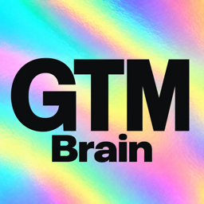

<a href="https://gtm-brain.ai/"></a>

# GTM Brain

GTM Brain gives Codex a memory for your go-to-market work: your rules, your strategy, what
customers said and where each campaign stands, kept as plain files in a folder on your computer.
Codex reads them and saves to them in every chat. Open source, [MIT](LICENSE).

![The brain in one picture. Configuration, on the left, says what is allowed: it sets the fields and kinds of entities and checks every save into memories, and it changes only when you edit the file or approve a change Codex proposes. Entities are who and what the memories are about; names resolve and links derive from the memories. Codex, where you talk, is the only thing that reads your tools, reads the brain and saves into it. Notes and entities keep a link back to their source in your tools. Workflows, underneath, run through Codex under the rules and save each step as a note.](docs/images/brain-in-one-picture.svg)

## 1. Install

You need the Codex desktop app and Node 22.16+ or 24+. Open a new Codex chat and send:

```text
Read https://github.com/gtm-week/gtm-brain/blob/main/INSTALL.md and follow it exactly. Read nothing else in that repository.
```

## 2. Start

Open a new Codex chat in an empty folder and send `/gtmb-start`. It creates the brain, asks
about your business and connects your tools, one short question at a time.

To connect a tool later, say "connect my tools" or "set up Clay for me". A tool connects only
on your yes.

## 3. Set it up

In this order:

1. **Rules and schema.** `/gtmb-rules` sets what Codex saves and what it asks first.
   `/gtmb-schema` sets what is kept about each person and company.
2. **Base documents.** Five short documents Codex reads before it works: your tone of voice
   before an email, your ideal customer profile before a prospect list. They start empty.
   Fill one by typing its command: Codex asks you a short series of questions, shows a draft
   and saves it when you say yes.

   | Document | Type this | You get |
   | --- | --- | --- |
   | Strategy | `/gtmb-strategy` | Where the company is going and what matters this quarter |
   | Ideal customer profile | `/gtmb-icp` | Who buys, why, and who is involved in the decision |
   | Market | `/gtmb-market` | Who you compete with and where you win or lose |
   | Tone of voice | `/gtmb-voice` | How you sound, drawn from your real writing |
   | Design system | `/gtmb-design-system` | How your pages look, built from your existing site |

   Already have one written? Paste it and say "save this as our strategy". To change one later,
   say what to change, or open it on the dashboard under Configuration and press Edit. To add
   your own, say "add pricing as a base file".

## 4. Use it

Talk to Codex in the brain's folder as you normally would:

```text
just got off a call with Anna Lind at Acme Retail, they want a pilot in March
what do we know about Acme Retail?
what is waiting on me?
open the dashboard
```

## More

- [Everyday use, the dashboard, updating](docs/GUIDE.md)
- [Skills marketplace](docs/SKILLS.md)
- [How it works and what is on disk](docs/HOW-IT-WORKS.md)
- [Everything else](docs/README.md) · [Contributing](.github/CONTRIBUTING.md) · [Issues](https://github.com/gtm-week/gtm-brain/issues)

## License

[MIT](LICENSE). Bundled dashboard dependencies and fonts retain their own licenses:
[third-party notices](plugins/gtm-brain/scripts/gtm-brain-render/ui/THIRD-PARTY-NOTICES.md),
[font license](plugins/gtm-brain/scripts/gtm-brain-render/ui/FONT-LICENSE.md) and
[shadcn license](plugins/gtm-brain/scripts/gtm-brain-render/ui/SHADCN-LICENSE.md).
