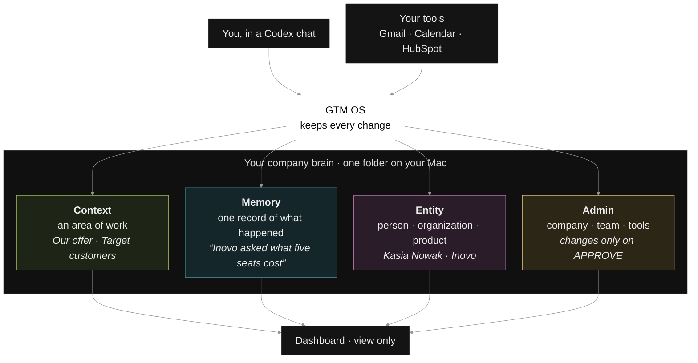

# GTM OS: step-by-step setup, with troubleshooting

<!--
Source of truth for the Circle onboarding guide. Paste the rendered Markdown into Circle's
editor, then convert each prefixed blockquote into a callout:
  ✅ You should see  -> green callout    💡 Tip -> blue callout
  ⚠️ Warning         -> yellow callout   🛠 If it goes wrong -> red/grey callout
HTML comments like this one carry Linear ticket references for maintainers; they do not
paste into Circle. Version referenced: GTM OS 0.27.0.
-->

This guide takes you from nothing to a working GTM OS in about 30 minutes, one click at a
time. Each step says what to do, what you should see, and what to do if you see something
else. If you get stuck anywhere, jump to **Troubleshooting index** at the end.

---

## 1. Before you start

You need three things GTM OS cannot do for you:

- **The Codex desktop app**, installed and signed in with your ChatGPT account.
- **A GitHub account.** GTM OS is distributed from a private GitHub repository; you will be
  invited to it. You will not need to use GitHub after that.
- **A Mac.** GTM OS runs locally on your machine; nothing is hosted.

> ⚠️ **Windows:** GTM OS is recommended on a Mac and **has not been tested on Windows**.
> It may run if Git for Windows is installed first (it provides the tools GTM OS's safety
> locks need), but folders will not open automatically and custom skills need Windows
> developer mode. If you are on Windows, ask in the community before you start, and expect
> to be the first.

> 💡 **Tip:** Have these to hand before you start: your company website address, your
> teammates' names and emails, and the sign-in for your CRM (HubSpot or Attio), Gmail and
> Google Calendar. Setup will ask for them.

---

## 2. Get access

<!-- ALL-216: Google Form -> Apps Script -> GitHub App invite -->

1. Fill in the access form at **https://forms.gle/rWsHoPutCdD7Vcuo9** with your **GitHub
   username** (not your email). Your username is the part after `github.com/` on your
   profile page.
2. Within a few minutes, GitHub emails you an invitation to the `gtm-week/gtm-os`
   repository. Open it and click **Accept invitation**.

> ⚠️ **Warning: you must accept the invitation.** Filling in the form is not enough. Until
> you click **Accept invitation** in GitHub's email, you have no access to GTM OS and the
> install in step 4 will fail. If you cannot find the email, go to
> **github.com/gtm-week/gtm-os** while signed in to GitHub; a pending invitation shows
> a banner with an Accept button.

> ✅ **You should see:** the `gtm-week/gtm-os` repository page opens on GitHub without
> a 404. You are in.

> 🛠 **If it goes wrong:**
> - **No invitation email after a few minutes.** Check spam, then check the username you
>   submitted. A typo shows as `USER_NOT_FOUND` on our side; re-submit the form with the
>   exact username from your GitHub profile page.
> - **"You already have a pending invitation."** You were invited earlier. Go to
>   github.com/notifications or the repository URL and accept from there.
> - **Install later fails with "Missing or invalid credentials".** Codex is not signed in
>   to GitHub on this machine. In the Codex chat, say "sign me in to GitHub" and follow
>   the prompt, then repeat the install step.

---

## 3. What you are setting up

What you are setting up: a **company brain**, a folder on your computer where Codex keeps
your company's contexts of work (Our company, Strategy, Market, Target customers, Our offer,
plus your personal context), the notes in each, and your workplace info. Plain text, in git,
yours. Codex learns your business from what it can see and from your corrections.

---

## 4. Install GTM OS

1. Open the **Codex app**.
2. Start a new chat in any folder (it does not matter which yet).
3. Paste this and press Enter:

   > Read https://github.com/gtm-week/gtm-os/blob/main/INSTALL.md and follow it
   > exactly. Read nothing else in that repository.

4. Codex will show **permission prompts** as it goes. Each one names what it is about to
   do. Read the line, then click **Approve**. Expect roughly:
   - checking this computer has everything it needs
   - installing GTM OS
   - turning on the safety locks (see the warning below)

> ⚠️ **Warning:** Do not skip the **safety locks** prompt (Codex may call it "trust
> hooks"). The locks do two things: they make every chat open where the last one ended
> (your dashboard, your loaded contexts, auto-save), and they stop anything important
> changing without your say-so. Without them GTM OS still works, but you will have to
> drive everything by hand. <!-- ALL-126 -->

> ✅ **You should see:** Codex says installation is done and it checked it works, then
> gives you **one next action**: create your company project. It should not hand you a
> long checklist.

> 💡 **Tip:** To confirm the version at any time: in the Codex app open **Settings >
> Plugins** (or say "which GTM OS version do I have?" in a chat). This guide was written
> for **0.27.0**. <!-- ALL-183 asks for the click-level version check -->

> 🛠 **If it goes wrong:**
> - **"Marketplace add failed" / network error.** Check your internet connection and that
>   you accepted the GitHub invitation (step 2). Paste the install prompt again; re-running
>   it is safe.
> - **"Safety locks: off" or Codex says the locks are still off.** Paste the install
>   prompt once more. If they stay off, carry on anyway: everything works, and Codex will
>   offer to turn them on later from inside your project.
> - **Codex asks "why does it update Codex?" or updates the Codex app itself.** The
>   install checks the Codex app is recent enough (0.149 or newer) and updates it if not.
>   Let it finish, then reopen the app and paste the install prompt again. <!-- ALL-124, open -->
> - **Codex offers a command that does not exist (for example `init`).** The app cached
>   an old list. Start a new chat; if it persists, fully quit and reopen Codex.

---

## 5. Create your GTM OS project

<!-- ALL-185/191/150: project creation vs linking; ALL-183 wants click-level steps -->

1. In the Codex app sidebar, click **New project** (or the **+** beside Projects).
2. Create an **empty folder**, wherever you keep your work, called **GTM OS**.
   The folder name is what the app shows as the project name.
3. Select that folder and open a **new chat** in it.
4. The first time, the app may ask whether to trust GTM OS's hooks. Click **Accept**.

> ⚠️ **Warning:** The folder must be **empty**. Do not point setup at a folder that already
> has your documents in it; GTM OS makes its own structure there. Your existing work
> folders are linked later (step 9), not used as the brain.

> ✅ **You should see:** a fresh chat in a project called GTM OS. On a greeting
> ("hi"), Codex offers to set up GTM OS here.

> 🛠 **If it goes wrong:**
> - **"Setup says the folder is not empty."** Create a new empty folder and use that. A
>   README or `.gitignore` is fine; anything else is not.
> - **The folder picker will not find your folder.** Press **Cmd+Shift+G**, paste the full
>   folder path, press **Return**, then **Open**.
> - **You are in the ChatGPT desktop app, not Codex.** Use **Projects > New project**, add
>   the local folder, save, select it and start a **New task**.

---

## 6. Run setup

1. In the chat you just opened, type **`/gtm-os-start`** (or simply "start") and press
   Enter.
2. From here Codex drives and you correct. It will:
   - check the machine and create the brain in your project
   - ask for the few things it cannot know: your company, what you sell and to whom, your
     name, your teammates, your tools
   - research your website and draft your **workplace info**
   - show the draft and ask you to correct it, then approve it

3. Answer in the **forms** Codex shows. You will see three kinds, titled by purpose:
   <!-- ALL-203 -->
   - **Setup question**: first-run setup only
   - **Settings question**: tools, connections, dashboard
   - **Your choice**: everyday decisions (which context, which direction)

4. When the workplace info draft looks right, type **`APPROVE`** (the exact word, capitals).
   Codex then asks permission to write an audit line; click **Approve**.

> ⚠️ **Warning:** Only the exact word **APPROVE** applies workplace info. "ok", "yes" or
> "looks good" do nothing, on purpose. This is the same for every future change to company
> facts.

> ✅ **You should see:** the dashboard opens in the right pane next to the chat, with a
> progress card showing the setup steps and where you are. Codex then moves to connecting
> your tools.

> 💡 **Tip:** You can stop at any point. Say **"stop"**, close the app, come back tomorrow.
> In the same project, say **"I'm back"** and setup resumes where it left off. You do not
> need any special continuation command. <!-- ALL-167 -->

> 🛠 **If it goes wrong:**
> - **A question form collapsed before you answered.** Click the **Answer question**
>   button in the chat to reopen it. If it is gone, type your answer as a normal message.
> - **Setup stalled and Codex went quiet.** Say **"I'm back"** or **"continue"**.
> - **The setup card keeps reappearing after you finished.** Say **"I already finished"**;
>   Codex records completion and the card stays closed. If you are on a version older than
>   0.20, update first (step 10). <!-- ALL-186 -->
> - **Codex talks about "channels".** That is old wording; it means **contexts**. Say
>   "compile" once and the old summaries are rewritten. <!-- ALL-184, ALL-212 -->
> - **Codex asks whether to import from Claude in the middle of setup.** Say "later"; it
>   is offered again at the end, and works any time (step 11).

---

## 7. The dashboard

The dashboard opens in the Codex right pane at every chat start. It is **view-only**: it
shows the brain, it never changes it. <!-- ALL-187, ALL-153 -->

- **Home**: questions that need you, proposed changes, possible duplicate names.
- **Contexts**: summaries, rules, notes and sources.
- **Entities**: people, companies, products and the evidence connecting them.
- **Admin**: workplace info, connections, linked working folders, version and update status.
- **Search**: press `/` to focus it.

Two click rules: <!-- ALL-199 -->

- **Left-click a button** to do what it says (Resolve these N, Open file).
- **Right-click a card or text** to **Chat about this**: Codex opens with a prepared message
  about that item. **You must press Send** in Codex; nothing happens until you do.

> ✅ **You should see:** after a right-click, a notice **"Opening Codex with a prepared
> message. Press Send there."** Opening takes a few seconds.

> 🛠 **If it goes wrong:**
> - **You clicked and "nothing happened".** Wait five seconds, then look at the Codex chat
>   pane: a prepared message is waiting for Send.
> - **The dashboard opened in Chrome or a search window instead of in Codex.** You are on
>   a version older than 0.21. Update (step 10); the dashboard now always opens inside
>   Codex and needs no login. <!-- ALL-207 -->
> - **"Resolve these N" seems to run forever.** On current versions it handles only the
>   items on screen and stops; a full sync is a separate command. If it is still running
>   after a couple of minutes, update. <!-- ALL-201 -->
> - **The dashboard shows an old version or "checked" days ago.** The first chat after an
>   update re-checks in the background; you may briefly see **"update check pending"**.
>   Start a new chat. <!-- ALL-211 -->
> - **"Connection lost" with a last-update time.** The local viewer server stopped. Start
>   a new chat in the brain project; it restarts.

---

## 8. Keep it fresh: the daily sync

<!-- ALL-189, ALL-132 -->

Setup recommends and verifies a **daily scheduled sync**. Fresh evidence reduces the
mistakes the brain makes from assumptions and unanswered questions. If you skipped it:

1. In the Codex app, open your brain project, then **Scheduled tasks**, then new task.
2. Paste as the task:

   > Run the gtm-os-sync skill as the scheduled run: compile every context whose summary is
   > behind with by: schedule, render the dashboard. Do nothing else.

3. Timing: daily (06:00) or weekly (Sunday 20:00). Choose **run in the local project**.
4. To see it work once, set the first run a few minutes ahead and keep the app open.

> ⚠️ **Warning:** The computer must be on and the app running at that time. If it was not,
> nothing is lost: the next chat opens with "N new notes since the last summary, compile
> now?" and a yes does the same by hand.

> 🛠 **If it goes wrong:**
> - **The task ran but nothing changed.** Check it is set to run **in the local project**,
>   not a background copy.
> - **You want to sync now.** `/gtm-os-sync` in the brain project.

---

## 9. Working folders

<!-- ALL-185, ALL-191, ALL-150, ALL-175; wording from ALL-187 -->

**A working folder is where you do the work. A context is the shared knowledge GTM OS brings
into that work.** You do not work inside the brain folder.

There are two different actions. Do not mix them up:

| You want | Say | What GTM OS does |
|---|---|---|
| a **new** folder for a piece of work | `/gtm-os-project`, choose **New** | creates it as a subfolder of the brain, with the contexts you pick |
| GTM OS to follow an **existing** folder | open that folder as a Codex project, `/gtm-os-project`, choose **Link** | attaches it as it is, flat; nothing is moved or restructured |

After linking, every chat in that folder opens with its own contexts and every note is
tagged with the folder. It is all still one brain, searchable from anywhere. Say **"list
projects"** to see them, **"unlink this project"** to stop.

> 💡 **Tip:** Setup asks at the end which existing Codex projects GTM OS should follow.
> Pick the ones whose future work should feed the brain, or skip; skips are remembered.
> Your existing files and chats are **not** imported by this choice.

> 🛠 **If it goes wrong:**
> - **The linked folder does not appear in the Codex sidebar.** Click **New project**,
>   press **Cmd+Shift+G** in the picker, paste the exact path Codex gave you, **Return**,
>   **Open**. The folder is already linked; this only shows it.
> - **"Nested or overlapping link rejected".** You tried to link a folder inside another
>   linked folder (or the brain itself). Link the outer folder only.
> - **Work from two projects is mixing.** Check each chat's opening line names the right
>   folder; a chat started in the brain folder is company-wide by design.

---

## 10. Updating GTM OS

<!-- ALL-130, ALL-154 -->

You will learn about a new version two ways: the dashboard **Home** shows "GTM OS x.y.z is
available; you have a.b.c" with an **Update** button, and the chat mentions it once. Codex
never updates without your yes.

The procedure, every time:

1. Say **"update GTM OS"** in any chat in the brain project (or click **Update**).
2. Let the verification finish. Codex checks the new version before installing it and
   refuses broken candidates and downgrades.
3. **Fully quit and reopen Codex** (Cmd+Q, not just close the window).
4. Open the prepared chat Codex left for you in the same folder and press **Send**, or
   start a new chat there.

> ⚠️ **Warning:** **Removing the installation or re-running setup is never the recovery
> procedure.** Your brain files are untouched by updates; do not delete anything.

> ✅ **You should see:** the new version under **Admin** on the dashboard, and the safety
> locks still on (an update re-approves them for you).

> 🛠 **If it goes wrong:**
> - **"Connector points to a missing plugin version".** Say **"repair the GTM OS update"**.
>   Codex checks whether files need repair or the app just needs a restart. <!-- ALL-154 -->
> - **Codex told you to remove the installation.** Do not. You are on an old version's
>   advice; quit, reopen, and say "repair the GTM OS update".
> - **Codex offers to "refresh the rules".** Say yes; it updates the brain's standing
>   instructions to the shipped version and changes nothing else.
> - **Update does not go through after a repair and a restart.** Report it (section 13)
>   with the version shown under Admin.

---

## 11. Optional: bring in what Claude knows

<!-- ALL-127 -->

If you have been using Claude Code (or Cursor, Gemini, another assistant) for company work,
it already knows your tools, people and deals. In **that assistant**, paste:

> Read https://github.com/gtm-week/gtm-os/blob/main/IMPORT.md and follow it
> exactly. Read nothing else in that repository.

It writes one file on your machine for you to review; nothing is sent anywhere. Then, in
the GTM OS chat, say **"import from claude"**. Every line is played back, you confirm, and
what you confirm is filed with its source. Workplace facts still go through APPROVE.

---

## 12. Troubleshooting index

The problem first, then what to do, grouped by the section it belongs to.

### Getting access (step 2)

***No GitHub invitation email***\
**→ Check spam; re-submit the form with the exact username**

***Install fails right after the form***\
**→ You did not accept the GitHub invitation yet; accept it, then retry**

***"Missing or invalid credentials" during install***\
**→ Sign Codex in to GitHub, paste the install prompt again**

### Installing (step 4)

***"Safety locks: off"***\
**→ Paste the install prompt again; else carry on, Codex offers later**

***Install updates the Codex app***\
**→ Let it finish, reopen, paste the install prompt again**

***Codex offers a command that does not exist***\
**→ New chat; then quit and reopen Codex**

### Creating the project (step 5)

***"Folder is not empty"***\
**→ Use a new empty folder**

### Setup (step 6)

***Question form collapsed***\
**→ Click Answer question, or type the answer**

***Setup stalled***\
**→ Say "I'm back"**

***Setup card keeps coming back***\
**→ Say "I already finished"; update if older than 0.20**

***Codex says "channel"***\
**→ It means context; say "compile" once**

### Tools and connections

***Tool shows "untested" after use***\
**→ Update; or "is HubSpot connected?"**

***Attio finds nobody***\
**→ Exact spelling; or "who is <name>"**

***Codex opens a browser instead of the connector***\
**→ Tell it to use the connector; ask it to repair the connection**

### Day-to-day work

***"Remembered" shows only names***\
**→ Update**

***New `/gtm-os-` command missing***\
**→ Quit and reopen Codex**

***Codex writes to-dos after sync***\
**→ Update**

***Long "refreshing dashboard" before every reply***\
**→ Update**

***"Summary needs updating due to manual editing"***\
**→ Expected; review the edit with Codex**

### The dashboard (step 7)

***Dashboard click does nothing***\
**→ Look at the Codex pane; press Send**

***Dashboard opens in Chrome***\
**→ Update (0.21+)**

***Dashboard shows an old version***\
**→ New chat; wait for "update check pending" to clear**

### The daily sync (step 8)

***Scheduled sync did nothing***\
**→ Set it to run in the local project**

### Working folders (step 9)

***Linked folder not in sidebar***\
**→ New project > Cmd+Shift+G > paste path**

***"Nested or overlapping link rejected"***\
**→ Link the outer folder only**

### Updating (step 10)

***"Missing plugin version"***\
**→ "repair the GTM OS update"**

***Codex says to remove the installation***\
**→ Do not; quit, reopen, "repair the GTM OS update"**

---

## 13. When to report a problem

<!-- ALL-136: "tell user to reset and if that does not work tell to report" -->

Before reporting, do the reset once:

1. Say **"update GTM OS"** and let it finish (step 10).
2. **Quit and reopen Codex** (Cmd+Q).
3. Start a **new chat** in the brain project.

If the problem is still there, post in the community with:

- the **version** shown under **Admin** on the dashboard
- what you said or clicked, and what happened instead
- a screenshot of the chat pane, if you can

Do not delete the brain folder or reinstall from scratch; nothing in this guide requires it,
and your notes are in that folder.

---

## 14. You did it

You now have what most teams keep in their heads and lose: what customers said, what you
decided and who is who, in one place you own, kept current by the tools you already use.
That was the hard part, and it is behind you.

From here the brain earns its keep one sentence at a time. Three habits for this week:

- **Open a context before you start**, so Codex works where you work.
- **Say what happened.** A decision, an answer, something sent: one line each.
- **Say yes to compile.** A summary that is behind is a brain that half-knows.

Before a call, `/gtm-os-deepdive`. When you do not know what to do next, `/gtm-os-todo`.
On Monday morning the summaries will be current and the dashboard fresh, without you doing
anything.

Welcome to GTM OS. See you in the community.
