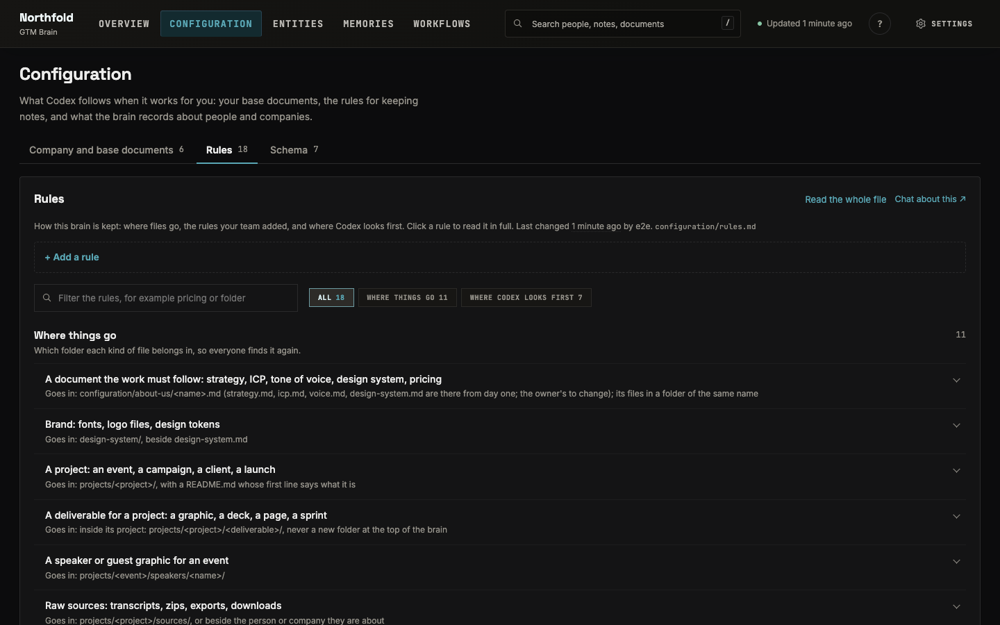
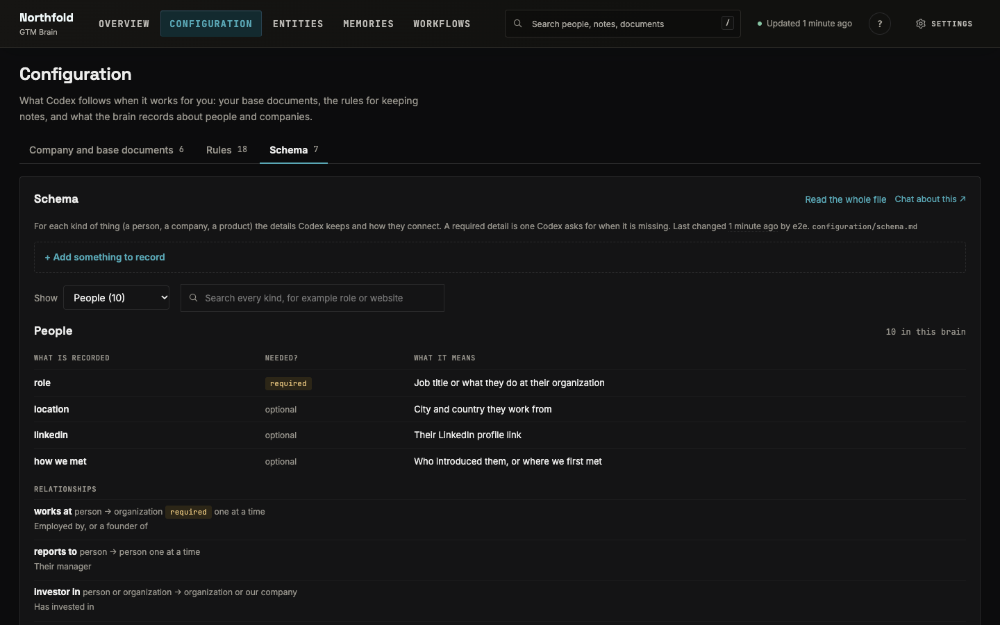
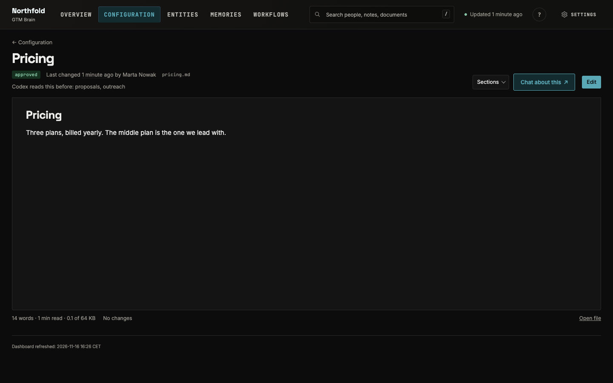
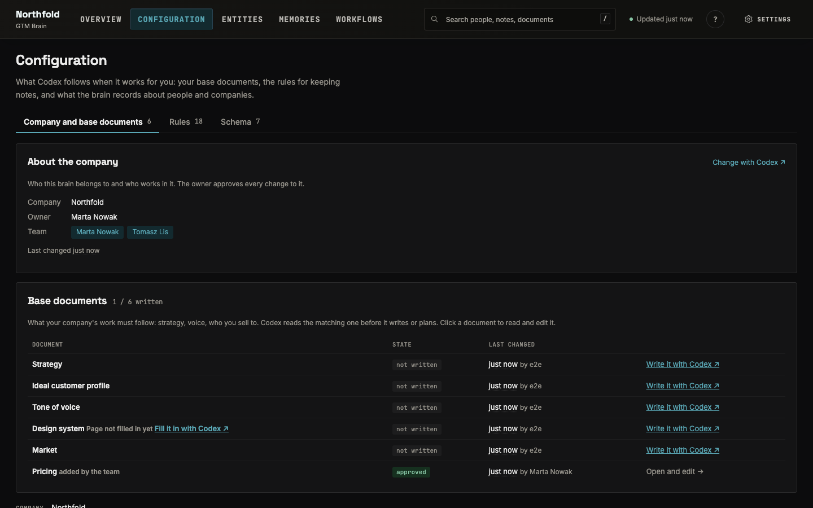
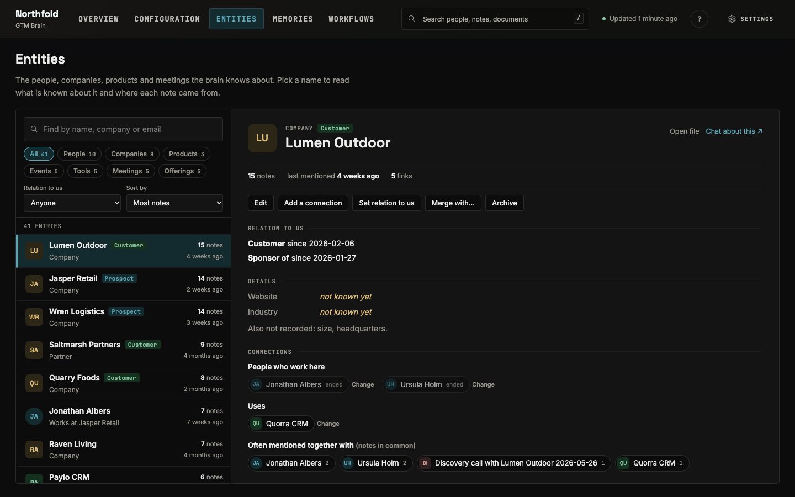
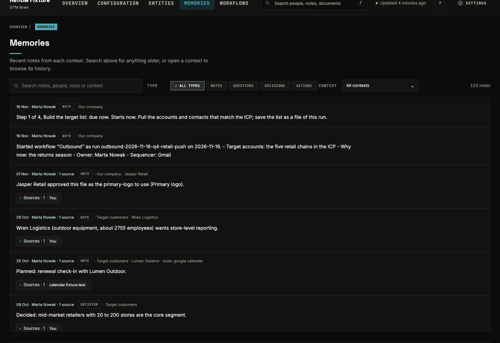
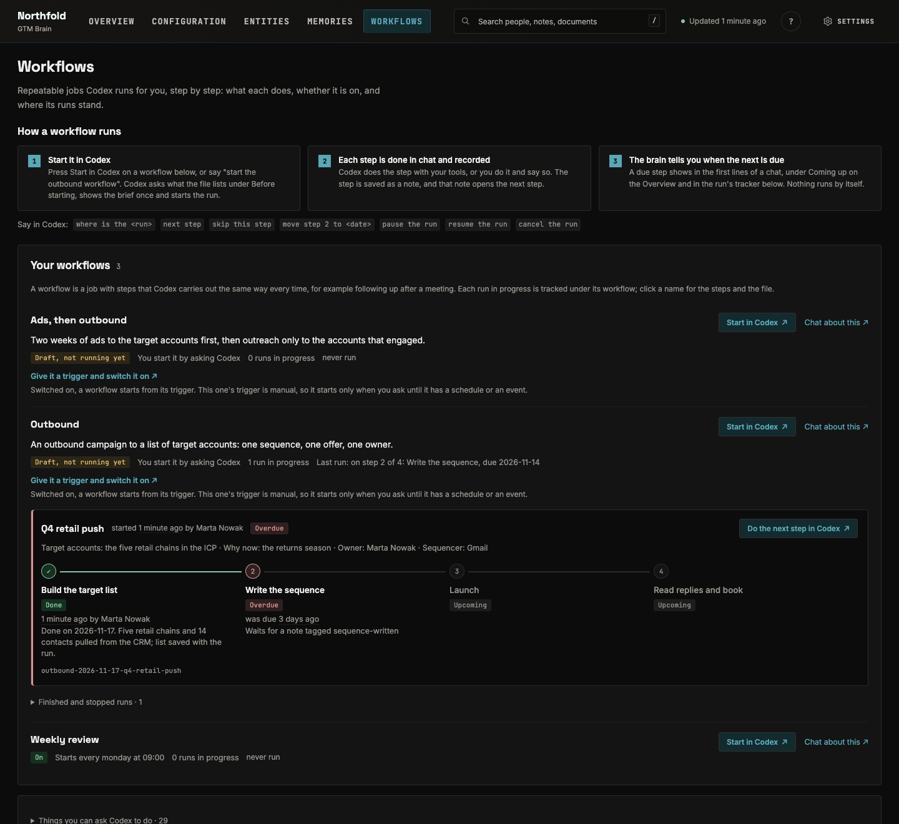
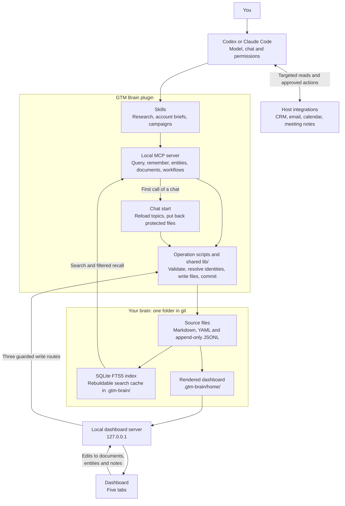
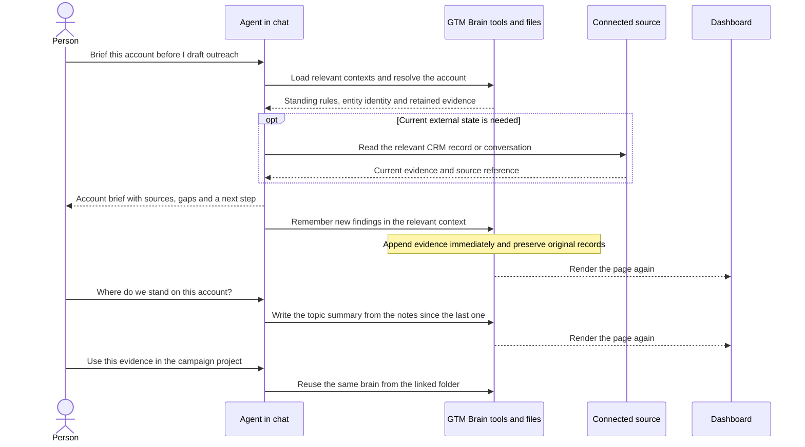

# How GTM Brain works

GTM Brain is a plugin that gives your agent a persistent, structured workspace for GTM work.
The host (Codex, or Claude Code in beta) provides the model, chat, permissions and connected
tools. GTM Brain provides the skills, memory operations, local files and dashboard. There is no
separate hosted GTM Brain backend to provision.

This page is the overview for someone reading the repository. How a brain behaves day to day,
and how to change it, is in [the manual](../plugins/gtm-brain/MANUAL.md), which ships with the
plugin; Codex answers "how does the brain work?" from it.

## The brain in one picture

![The brain in one picture. Configuration, on the left, says what is allowed: it sets the fields and kinds of entities and checks every save into memories, and it changes only when you edit the file or approve a change Codex proposes. Entities are who and what the memories are about; names resolve and links derive from the memories. Codex, where you talk, is the only thing that reads your tools, reads the brain and saves into it. Notes and entities keep a link back to their source in your tools. Workflows, underneath, run through Codex under the rules and save each step as a note.](images/brain-in-one-picture.svg)

Read it left to right. **Configuration** says what is allowed; it shapes the entities and checks
every save, and it changes only two ways (red): you ask in chat and approve what Codex proposes,
or you edit the file. **Memories** are what happened and **entities** are who and what they are
about. **Codex** is where you talk, and the only thing that reads your tools, reads the brain
and saves into it. **Your tools** keep the raw material; a dashed line is the link a note or an
entity keeps back to its original. **Workflows** are the part that acts: they run through
Codex, under the rules, and leave each step as a note.

- **It is a folder of plain files in git on your computer.** Nothing is stored anywhere else.
- **You talk, Codex saves.** What happened, was decided or is open becomes a dated note with
  its source. Notes are never edited; a correction replaces the old note and keeps it. Codex
  never guesses who someone is: it saves the note and asks.
- **People, companies and products are linked across notes,** with their relationships and
  history (who worked where, who is a customer).
- **Your rules and schema decide** what Codex saves and asks, where files go, and what is kept
  about each person and company.
- **Your base documents steer the work:** strategy, ideal customer profile, market, tone of
  voice, design system. Codex reads them before the work they apply to. Mentors are how you
  fill them.
- **The dashboard shows the same files:** what needs you, housekeeping, entities, notes,
  workflows and configuration. Documents, entities and notes can be edited there.

## What it solves

| The work you keep repeating | What GTM Brain does |
| --- | --- |
| **Re-explaining who you sell to and why you win.** Every research or campaign chat needs the same ICP, offer, proof and messaging rules. | Keeps those as standing documents and shared context. Linked project folders use the same brain, so a new project can reuse what you have already established. |
| **Reconstructing an account from CRM records, emails and call notes.** The useful detail is scattered, and yesterday's summary may miss today's change. | Builds a sourced account brief from retained evidence and targeted reads of connected tools: where things stand, who is involved, what happened and what remains unanswered. |
| **Losing the state of a multi-step GTM playbook.** The prompt is saved, but which step ran, what is due and what needs approval are not. | Keeps reusable playbooks (workflows) with tracked runs, steps, dates and approval gates. Resume a run in chat with its recorded progress. |
| **Getting a GTM recommendation you cannot check.** Market claims lack evidence; CAC and LTV use incompatible inputs. | Runs sourced market research and unit-economics reviews that expose evidence, assumptions and missing inputs. You can inspect the basis for the conclusion. |

## The four parts of a brain

The picture in words: four parts, with Codex and your tools around them.

| Part | What it is | On disk | Dashboard tab | Changed with |
| --- | --- | --- | --- | --- |
| [Configuration](#configuration) | What is allowed and what the work must follow: rules, schema, settings, base documents | `configuration/` | Configuration | `/gtmb-rules`, `/gtmb-schema`, `/gtmb-configure`, the document commands |
| [Entities](#entities) | Who and what the notes are about: people, companies, products, events | `entities/<kind>/` | Entities | what you say in chat, or the Entities tab |
| [Memories](#memories) | What happened, was decided or is open: dated notes, grouped by topic | `memories/` (a file per month; `topics/` for each topic's summary) | Memories | what you say in chat, or the Memories tab |
| [Workflows](#workflows) | The part that acts: processes with steps, gates and a trigger | `workflows/` | Workflows | `/gtmb-workflow` |

How the parts act on each other:

1. **Configuration shapes the entities.** The schema sets the kinds, their fields and the
   relationship types.
2. **Configuration checks every save.** A check rule refuses a note that breaks it; only a
   relationship type the schema lists is saved as a relationship.
3. **Memories feed the entities.** Names in a note resolve to entities; an entity's fields,
   relationships and relation to us are worked out from the notes, each with its citation.
4. **Codex is the only reader and writer.** It reads your tools, reads the brain and saves into it.
5. **Notes and entities link back** to the record they came from in your tools.
6. **Workflows run through Codex, under the rules,** and leave each step as a note. A saved note
   can in turn start a workflow.

### Configuration

Four things, read at the start of every chat.

| File | What it holds | Change it with |
| --- | --- | --- |
| `configuration/rules.md` | Three parts: Where things go, Ask the source, Our rules | `/gtmb-rules`, or edit the file |
| `configuration/schema.md` | The fields per kind, organization subtypes, relationship types | `/gtmb-schema`, or edit the file |
| `configuration/settings.yaml` | Company and one-liner, team (handles and emails), tools, settings | `/gtmb-configure`; applies on APPROVE |
| `configuration/about-us/*.md` | Base documents: strategy, ICP, voice, market, design system, and yours | their commands, "add pricing as a base file", or Edit in the dashboard |

Two things to know:

- A change to rules, schema or a base document is saved at once and recorded. A change to
  company, team or tools, and a new interaction, is shown first in a form and applies only on
  APPROVE.
- APPROVE is a click in the form Codex shows. Typing APPROVE, "ok" or "yes" in chat changes
  nothing.

The whole list, with what each change does, is in
[How a brain works: Changing how it works](../plugins/gtm-brain/MANUAL.md#changing-how-it-works).

#### Rules

`configuration/rules.md`: your rules, followed over GTM Brain's defaults. A change applies from the next chat; an update never overwrites a file you edited.

- **Where things go:** a table of where each kind of file lands. Codex files everything by it
  and names the row it used; when no row fits it asks and offers a new row. Ask "why is this
  here?" about any file. Shipped rows include: files over 25 MB go to the shared drive,
  deliverables go inside their project, names are lowercase with hyphens.
- **Ask the source:** when Codex reads the live tool instead of a saved note. Deal stage: CRM,
  after 1 day. Meeting times: calendar, always. Latest email in a thread: email, always. Edit
  the rows ("1 day", "2 weeks", "always ask", "no limit"). A row counts only while that tool is
  connected; otherwise the brain answers and says how old its note is.
- **Our rules:** one line per rule, in your words, for what Codex saves and asks. On your yes
  Codex files a rule with a tag line (`> applies to: organization · when: saving customer
  status · check`). A check rule such as "Never call a company a customer before a signed
  contract" then refuses a save that breaks it and quotes the rule. Four forms can be checked:
  a quoted word that must not appear, a status only before or without a fact, a note never
  without a source, a schema field always included. Any other rule is shown as guidance.
- **What a rule cannot do:** start work ("whenever X, do Y" is offered as a workflow), switch
  off APPROVE or the protected files, or move files that already exist.

The file format in detail: [COMMANDS.md: rules.md](COMMANDS.md#rulesmd).



#### Schema

`configuration/schema.md`: what the brain keeps about each kind.

- **Kinds.** Seven ship: person, organization, product, offering (what we sell), event, tool,
  meeting. Add your own with a `## <Kind>` section and a field table ("track venues"). A
  project is a tag, never a kind.
- **Fields.** Each kind has a table of fields and marks the required ones: a person's role, an
  organization's website and industry, a product's category, an event's date.
- **Values are never typed into the schema.** Codex fills them on the entity page from your
  notes, each with its citation, and never invents one. A required field nobody has stated
  shows as a gap with the question to ask.
- **Subtypes** exist only on organizations (company, team, investor, partner, community) and
  can have fields of their own.
- **Relationships.** The table lists the types Codex may save: `works_at`, `reports_to`,
  `partner_of`, `investor_in`, `uses`, `speaker_at`, `attended`, `competes_with`, `integrates_with`,
  `customer_of`. A type marked One at a time ends the previous one when a new one starts, so
  "Anna joined Acme" also ends her job at Northwind. An unlisted type is saved as a plain note
  with an offer to add it.

The file format in detail: [COMMANDS.md: schema.md](COMMANDS.md#schemamd).



#### Documents

A document is a Markdown file the work must follow. The five base documents (strategy, ideal
customer profile, market, tone of voice, design system) live in `configuration/about-us/`;
any other document stays in a folder you name. Before work of a listed kind Codex reads the
matching document in full, follows it and says which one. How documents are made, approved
and kept: [DOCUMENTS.md](DOCUMENTS.md).



#### Settings

`configuration/settings.yaml`. Beside company, team and tools it holds:
dashboard timing (`dashboard: always` or `on-demand`), the save reminder (`save_nudge: off`),
workflows on or off (`workflows: off`) and where big files go (`big_files: google-drive` or
`local`). A change is shown first and applies only when you click APPROVE.



### Entities

One page per person, organization, product, offering, event, tool or meeting, at
`entities/<kind>/<name>-<short id>.md` (`entities/people/anna-lind-3f9a2c.md`). Facts stay in the notes; the page is the identity
and a cited brief built from them.

| What | How it works | Say |
| --- | --- | --- |
| Identity | One id through renames. An alias adds a name and never merges two records | "Ann is Anna Lind", "Acme is a company" |
| Names | Never guessed. A first name alone is saved as written and you are asked "Who is Anna?". Look-alike names are flagged "may be the same" and merged only on your yes; a "different" answer is kept, so the pair is not asked again | "who is Anna Lind" |
| Merge and archive | A merge is shown first, applied on your yes and can be undone; the old name still finds them. An archived entity keeps its notes | "Acme and Acme Inc are the same company" |
| Fields | Filled from your notes, each value with its citation. A required field nobody has stated is a gap with the question to ask | "check the brain against its rules" |
| Relationships | A note naming both ends and a type from the schema. Each is dated: started, changed, ended. Ended links stay as history. What you said beats what a tool says | "Anna left Northwind and joined Acme", "where did Anna work in June?" |
| Relation to us | Team, customer, partner, investor, prospect or other, worked out from your notes | "show the customers' VPs of Sales" |
| Meetings | A meeting is saved as what came of it and gets a page listing those notes and who attended. The transcript stays in its tool, linked from the page | "just got off a call with Acme: ..." |

A page's own Markdown may be edited by hand; say "save" afterwards. Files that belong to an
entity sit in a folder of the same name beside its page. Renames, merges and kind changes are shown under History
on the page. Detail: [How a brain works: Saving](../plugins/gtm-brain/MANUAL.md#saving-what-you-say-what-it-keeps).



### Memories

A memory is a note: one dated line in the file of its month (`memories/2026-11.jsonl`), never
edited afterwards. Each note names its topic.

- **What a note is.** A note, a decision or a question, with its author, date, the people and
  companies it names, tags (a project is the tag `project:<slug>`) and its source: the exact
  link to the record. The chat it came from is always kept.
- **Saving.** Say it once, in a plain sentence; you do not need to say "remember". A repeat is
  answered "already kept", a changed date or amount becomes a correction, and "we had a call"
  alone is not saved, only what came of it.
- **Correcting.** "Correct ..." or "actually it is the 19th" saves a replacement. "Forget
  that ..." withdraws a note. The old note leaves every answer and view but stays in the file
  and in git; a commit that changes an existing line is refused.
- **Topics** (contexts). Notes are grouped by topic: Our company, Strategy, Market, Target
  customers, Our offer, and yours. A note lands where its meaning fits, answers search every
  topic, and a new topic is made only on your yes. Rename, archive or fork one in chat.
- **Personal topic.** The topic `personal-<handle>` holds your role and working preferences;
  setup makes it.
- **A topic's cover** (`memories/topics/<topic>.md`) has three parts: your standing rule ("change the rule of
  Our offer to ..."), a short summary where every sentence cites its notes, and working
  guidance Codex learned there.
- **Summaries are written when you ask:** load the topic, "where do we stand on pricing?" or
  "update the summary". The summary is written in that chat and kept until new notes arrive.
  Nothing runs after a save. Answers always search the notes, so a summary that is behind
  never makes an answer wrong. A weekly Codex Scheduled task is optional.
- **Open questions.** The brain keeps its questions ("Who is Anna?", "who signs for Acme?")
  until you answer. Ask "what is open?"; your answer is saved as the note that closes the question.
- **Chat capture.** What you decided in a chat but never saved is picked up by the nightly run
  and saved as notes tagged `captured`, each resting on an exact sentence. The next chat lists
  them and "undo captured" withdraws them.
- **Asking.** Ask in your own words ("what did Anna want last week?", "decisions in October").
  One search over every topic returns the notes with date and source and the card of whoever
  you named, or says plainly that nothing was found.

Detail: [Contexts](../plugins/gtm-brain/MANUAL.md#contexts) ·
[Summaries](../plugins/gtm-brain/MANUAL.md#summaries) ·
[Chat capture](../plugins/gtm-brain/MANUAL.md#chat-capture).



### Workflows

A workflow is a file in `workflows/`: skills in sequence, with a gate between steps. A playbook
is a workflow. Every new brain starts with two drafts, `outbound.md` and
`ads-then-outbound.md`: edit them, or say "make a playbook for ..." to write your own. Nothing
runs silently or reaches you outside Codex: a due step or a fired trigger shows in the chat's
opening lines, in the todo list and on the dashboard, and starts only on your yes. The header,
steps, triggers, runs and limits: [WORKFLOWS.md](WORKFLOWS.md).



### Skills, projects and interactions

Three things sit beside the four parts and are easy to confuse with a workflow.

| Thing | What it is | Where it lives |
| --- | --- | --- |
| Shipped skill | One sitting of work. Twenty-nine ship with the plugin as `/gtmb-<name>`: [the list](SKILLS.md). Not yours to edit | the plugin |
| Your own skill | The same, made by you. Kept in the brain and through updates | `.agents/skills/gtmb-<name>/` |
| Workflow | Skills chained into steps, with gates and a trigger | `workflows/` |
| Interaction | One approved action in your own tool, done and recorded the same way every time | `configuration/interactions.json` |
| Project | A folder for files plus a tag on notes; never a second brain | `projects/<slug>/`, or a folder linked from elsewhere |

- **Your own skills.** Say "make this a skill" after a piece of work. Codex shows the draft
  and saves it on your yes; it appears as `/gtmb-<name>` after you quit and reopen Codex.
  Detail: [USER-SKILLS.md](USER-SKILLS.md).
- **Interactions.** Say `/gtmb-interaction`, or "propose an interaction for moving a deal in HubSpot". After your
  APPROVE it is kept in `configuration/interactions.json`. Each time it runs, Codex does it in the
  tool first and saves the note only when the tool confirms; a failed write is saved as a failure.
- **Projects.** "create a project for the Berlin event" makes `projects/berlin-event/` in the
  brain. "link this folder" connects a folder where it already lives, such as a code
  repository. People and companies stay shared, a note goes to the topic its meaning fits and
  carries `project:berlin-event`, and "unlink this project" removes only the link. One folder
  belongs to one brain; nested projects are refused. Detail:
  [Work in your own folders](GUIDE.md#work-in-your-own-folders) ·
  [One brain, many projects](../plugins/gtm-brain/MANUAL.md#one-brain-many-projects).

## How it fits together



**Skills coordinate the work.** They tell the agent how to research, brief an account, review
unit economics or advance a playbook. Detailed procedures are loaded when needed. The agent
calls small MCP operations; operation scripts use shared library readers, validators and writers.

**Files retain the evidence.** A note is appended to JSONL at once. A correction adds a new
record with `supersedes`; a withdrawal or an answered question uses `retracts`. Old records
stay. Entity pages link those records across topics without copying the facts into a second store.

**The file format validates three record types:** a topic's cover (`memories/topics/<topic>.md`), a note
(a line of a month's file in `memories/`) and an entity page. Configuration and workflows are plain Markdown and YAML
read beside them. The model to keep in mind is still
[the four parts](#the-four-parts-of-a-brain).

**The index makes recall practical.** A local SQLite FTS5 index supports keyword search,
alias expansion, exact filters and read-only SQL for counts, joins and dates. It is a rebuildable
cache under `.gtm-brain/`; Markdown and JSONL remain authoritative.

**The dashboard renders the same state.** A Node renderer builds the page from the brain's
files. A local server serves it, with revision events so an open page updates. The server's
only writes are three routes, for documents, entities and notes
([The dashboard](GUIDE.md#the-dashboard)): each is one call of the script the chat tools run, accepted
only from the page itself.

## From a call note to the next campaign



A new chat restores the working context on its first GTM Brain call. Loading a context brings in
its standing rule, summary, working guidance and recent memories. It does not load every
transcript or every account into the prompt. Broader recall searches across the brain when needed.

Notes are saved immediately. A summary is written when you ask about its topic, never by a run
after a save; the chat says how old it is ("as of 12 Nov, 4 newer notes"). A summary you edited
by hand is paused until you review the edit in chat. Refreshing a summary is not a live check
of its sources.

## What is stored on disk

A brain is one folder. Each of [the four parts](#the-four-parts-of-a-brain) has its place in it,
and the dashboard's tabs show the same parts.

```text
your-brain/
  configuration/                    What is allowed and what the work must follow
    about-us/                       Base documents
      strategy.md  icp.md  voice.md  market.md
      design-system.md  design-system.html
    rules.md                        Where things go, Ask the source, Our rules
    schema.md                       Fields per kind, organization subtypes, relationship types
    settings.yaml                   Company, team, tools and settings
    interactions.json               Your company's own interactions, once one is approved
  entities/                         One page per person, company, product, event, tool, meeting
    people/  organizations/  products/  events/  tools/  meetings/  offerings/
  memories/                         The notes: one per line, never edited
    2026-11.jsonl                   One file per month; each note names its topic
    topics/                         Per topic: the standing rule, summary and working guidance
      company.md  icp.md  market.md  offer.md  strategy.md  personal-<handle>.md
  workflows/                        Processes with steps; a run's state is kept as notes
  projects/                         Working folders for an event, a campaign, a client
  .agents/skills/                   Skills you made
  layout.json                       The file layout of this brain (4)
  AGENTS.md  CLAUDE.md  README.md   Written by GTM Brain and refreshed on update
  .gtm-brain/                       This computer only, not in git: search index, dashboard, caches
```

What you may edit by hand:

| File | A hand edit |
| --- | --- |
| Entity pages, your own documents, workflows | Kept. Say "save" afterwards |
| `configuration/about-us/`, `configuration/rules.md`, `configuration/schema.md` | Kept and recorded |
| `configuration/settings.yaml` | Change it through APPROVE. A file deleted or left without its company or team is put back |
| A month's notes (`memories/*.jsonl`), `configuration/interactions.json` | Put back; your version is kept in `.gtm-brain/manual-edits/protected/`. Correct a note in chat instead |
| `AGENTS.md`, `CLAUDE.md` | Rewritten on update. Your own lines stay under "This brain's own additions" |

A brain made before 0.37 keeps the same files in other places (a `brain/` folder for notes and
entities, `work/` for this computer's files; before 0.35 also `RULES.md` and `SCHEMA.md` at the
top and its settings in `brain/admin.md`) and works as it is until you say "upgrade the brain"
([Updating to 0.37](../plugins/gtm-brain/MANUAL.md#updating-to-037-the-four-folders)).

The plugin's source and your brain are separate folders. Updating the plugin does not replace
your memories, documents or custom skills. Every change is committed to the brain's own git
history at once. Files over 25 MB never go into git: they go to the shared drive or a folder
outside git, and the note keeps the link.

## Sources, permissions and boundaries

CRM, email, calendar and meeting sources come through the host's connected integrations,
with their own accounts and permissions. GTM Brain retains useful findings and exact source
references; it does not mirror every record. Broad source sync runs on request or on an
approved schedule. A targeted live read follows the Ask the source table in
`configuration/rules.md`. How tools are connected and synced: [Your tools and sync](GUIDE.md#your-tools-and-sync).

Customer evidence can exist without a CRM record. Meeting records distinguish scheduled events
from evidence that a conversation happened, and distinguish available notes or transcripts
from missing content. Neither a cached summary nor a calendar invitation proves the current
state of an account.

External sends, account changes and other actions go through the relevant integration and its
permission flow. A workflow records prerequisites, step progress, dates and gates; its tracker
does not perform the step by itself. The agent carries out authorized work through connected
tools and then records what happened.

Relevant content is processed by your AI host and connected services. Local file ownership
does not mean offline AI processing.

## What it does not do

The list lives in the manual: [What it does not do](../plugins/gtm-brain/MANUAL.md#what-it-does-not-do).
