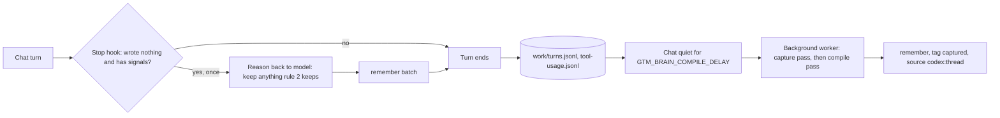

# Enforced capture and structured knowledge for GTM Brain

Today a memory exists only if the chat model chose to call `remember`. Its shape is free prose
plus a list of names. This plan ships both fixes as GTM Brain 0.33.0 on Friday 2026-11-13:
- **Capture becomes a system behaviour:** a turn-end check, plus a background capture run
  over chat transcripts.
- **Knowledge gets typed facts** from a fixed GTM vocabulary, with mandatory conflict
  resolution.

Five work packages run in parallel in the cloud from Wednesday evening. Thursday is review and
merge; Friday is integration, local live tests and release. JSONL in git stays the only truth.
The Graphiti and Cognee extractor comparison moves to the week of 2026-11-16.

- **Owner** Łukasz Jakubowski
- **Home** gtm-os, branch to be decided (base `main` `fd653a1`, plugin 0.32.0)
- **Status** draft for review
- **As of** 2026-11-11

## 01 Summary [open]

The problem has two halves, and they need different tools.

| Half | Today | After this plan | Who solves it |
|---|---|---|---|
| Writes happen | One rule (line 272 of 568 in `templates/AGENTS.md`); hooks only log; no test covers unprompted capture | Turn-end check (Stop hook) plus a background capture run over transcripts | GTM Brain harness. No library enforces writes; a library only sees what it is given |
| Knowledge is well structured | Prose plus names; corrections only if the model links them; no time validity | Typed facts `(subject, relation, object, from, to)` validated against a vocabulary; conflicts resolved before a write; derived `facts` table | GTM Brain schema and lib. Graphiti or Cognee may supply extraction if they measurably beat the native path |

The evidence so far:

- The one real brain on this machine (GTM OS 0.9 to 0.20, September 2026, a small sample)
  wrote memories in 8 of 17 interactive turns. A pasted Slack thread on 2026-09-13 produced
  no memory.
- On a synthetic brain with 50,000 memories, reads stay fast (0.12 s recall), but the input to
  one context's summary run is 1.46 MB. More capture brings that limit forward, so incremental
  compile is part of this plan.

## 02 Decisions [contract]

What stays fixed whatever the phases find:

1. `brain/contexts/*/memories.jsonl` and `brain/entities/*.md` stay the only truth. Every write
   goes through `remember` and `lib/`, append-only, one commit per memory.
2. Every captured or extracted item cites its source (`codex:<thread>` or `claude:<session>`,
   plus the connector reference) and carries the tag `captured` when the chat did not write it.
3. Identity merges stay human-confirmed. Automatic matching may add an alias only when the
   match is exact on email or an external record ID. Everything else becomes a `brain-question`.
4. The relation vocabulary lives in the plugin ontology. A company extends it only through
   `propose_interaction`-style review and APPROVE.
5. A third-party library, if adopted, runs as an opt-in sidecar enabled per brain through
   APPROVE, because it sends customer text to its own LLM. The plugin runtime stays Node
   built-ins only.
6. The harness bench and its token budget (`GTM_BRAIN_BENCH_MAX_OVERHEAD`, 14000) must still
   pass after every phase. Capture must not fire on work that is not GTM.

Alternatives rejected:

| Alternative | Why not |
|---|---|
| Cognee or Graphiti as the memory store | Breaks append-only truth in git, citations by memory ID, and runtime without dependencies; the LLM data flow becomes the default |
| Mem0 | Graph memory moved to the paid platform; the 2026 open-source algorithm is ADD-only; built for user preferences, not account facts |
| Raw transcripts committed to the brain | Noise and privacy: drafts and excluded items would land in git. Transcripts stay host-local; only extracted memories are written |
| Stronger wording in AGENTS.md only | Already tried: the rule exists and is not followed reliably. Instructions alone are not enforcement |
| A blocking "you must remember" on every turn | Costs a model step on every turn and fails the bench on non-GTM work |

## 03 Part A: enforced capture [open]



### A1 Measurement first

- **Positive live cases** in `test/live/` (new file `capture-cases.mjs`, run through the
  `tool-routing.mjs` harness). Every prompt has no save verb:
  - a pasted Slack or email thread;
  - a HubSpot fixture read that shows a deal stage change;
  - "draft a reply to Pierre, he said the budget moved to Q2";
  - a meeting note read from the fixture transcript source.
  Each case checks that a sourced memory exists afterwards.
- **Negative cases** that must write nothing: an unsent draft, a private calendar lookup, a
  lookup that changes nothing, the bench's self-contained puzzle.
- **Offline report**, `scripts/gtm-brain-advisor/capture-report.mjs <brain>`, reading only:
  - interactive turns (scheduled and background runs excluded via `GTM_BRAIN_RUN` prompts);
  - the share of turns with a write;
  - turns that used a non-GTM MCP server but wrote nothing;
  - nudges fired and nudges that led to a write (from A2).

### A2 Turn-end check (Stop hook)

Both hosts let a Stop hook answer `{"decision": "block", "reason": "..."}`. The host then hands
the reason back to the model instead of ending the turn. `hooks/turns.sh` already runs on Stop
for both hosts, so neither `hooks.json` nor `claude-hooks.json` changes.

| Rule | Detail |
|---|---|
| Where | Only when `resolve.sh` finds a brain; never when `GTM_BRAIN_RUN` is set |
| Once | Skip when the payload has `stop_hook_active: true`, so it cannot loop |
| Wrote nothing | No `remember` row in `work/tool-usage.jsonl` for this session since the last prompt row |
| Signals (any one) | a non-GTM MCP call this turn; a prompt over 400 characters; a registered entity name or email in the prompt (`lib.createMentionMatcher`) |
| Reason text | "Before you finish: did this turn establish anything rule 2 keeps (an outcome, a change seen in a tool, a commitment, a decision)? If so, remember it now in one batch. If not, finish without mentioning this check." |
| Log | One line per check in `work/capture.jsonl`: fired or not, signals, and whether a write followed |

Thresholds are starting values to tune on A1 data. After the change, re-run
`trust-hooks.mjs --trust`: from Codex 0.164 any plugin change drops hook trust.

### A3 Background capture run

- **Where it runs.** In the existing background worker (`background-compile.sh`), as a capture
  pass before the compile pass. A background run is a full model session; the worker comments
  measured about 400k input tokens for one note on 2026-10-01. Sharing one session for both
  passes avoids doubling that cost.
- **Input.** The transcript of each chat with new turns since its checkpoint:
  - Codex: `~/.codex/sessions/**/*-<thread>.jsonl`, found the way `lib.resolveThread` does.
  - Claude: `transcript_path` from the hook payload, which `turns.sh` starts recording in
    `work/session.json`.
  - Checkpoint per thread: `work/capture-state.json`, holding the last line read.
- **Tools.** A new toolset, `GTM_BRAIN_TOOLSET=capture`: `recall`, `who_is`, `query`,
  `remember` only.
- **Script.** `scripts/gtm-brain-capture/capture.mjs --facts <thread>` prints the new
  transcript slice. Next to it, it prints the memories already written from that thread
  (`source codex:<thread>`) and the exclusions the person stated. The model writes only what
  is missing.
- **Writes.**
  - Authors: the chat's person (`lib.currentPerson`).
  - Tags `captured` and `project:<slug>` when the chat is in a project.
  - A look-alike name: the note is written without that name linked, and a `brain-question`
    asks "same as X?".
- **Review.** The dashboard lists captured memories from the last 7 days with a "Chat about
  this" link to retract or correct them. The dashboard itself stays read-only.
- **Off switch.** An `admin.md` setting `capture: on | off`, through APPROVE. Default to be
  decided (see 08).

### A4 Lower write friction

- `remember` accepts `content` alone:
  - context: the single loaded context, otherwise an `inbox` context created on first use;
  - names that don't resolve stay as mentions; compile or capture links them later.
- The look-alike hold becomes "written, plus one question" instead of "nothing written".
- `session-start.sh` prints the capture rule in one line at every chat start.
- Changing `templates/AGENTS.md` needs the legacy snapshot and manifest entry. The upgrader
  test enforces both.

### A5 Incremental compile (enabler)

- `compile --facts` sends the previous cover plus the memories newer than `compiled_at`.
- Past a threshold (proposed: 300 new memories), it summarizes in time-ordered batches.
- From Part B on, it also sends the current facts for the context's entities.
- The same applies to `entityFacts` and `deal-health.mjs`.

## 04 Part B: structured knowledge [open]

### B1 Typed facts on memories

New optional field, added to `lib.MEMORY_FIELDS` and validated in `lib.validateMemory`:

```jsonc
"facts": [
  { "s": "e_<16 hex>",            // subject: registered entity id
    "r": "economic_buyer_of",     // relation from the vocabulary
    "o": "e_<16 hex>",            // object: entity id, or { "value": "...", "type": "stage|money|date|text" }
    "from": "2026-11-02",         // optional, defaults to the memory's at
    "to": null }                  // optional, set only when the source says it ended
]
```

- `content` stays required. It is the evidence and the citation.
- Readers that ignore `facts` keep working.
- The `remember` input schema carries the relation enum, so the host's structured output is
  held to it before lib sees it.
- An unknown relation or an unresolved entity id is an error naming the entry, as other
  validation errors are today.

### B2 Vocabulary

Declared in `ontology/gtm-brain.ossie.json` under the existing extension block. A company
extends it in `brain/ontology.ossie.json` through APPROVE. A proposed first set, to be signed
off in review:

| Relation | Subject, object | Cardinality |
|---|---|---|
| `works_at` | person, organization | one current |
| `role_at` | person, text | one current per organization |
| `champion_of` / `economic_buyer_of` / `blocker_of` | person, organization | many |
| `deal_stage` | organization, stage | one current |
| `deal_value` | organization, money | one current |
| `next_step` | organization, text plus date | one current |
| `committed_to` | person or organization, text plus date | many |
| `uses_tool` | organization, product | many |
| `competitor_of` | organization, organization | many |
| `customer_of` | organization or person, organization (us) | one current |
| `price_quoted` | organization, money | one current |

### B3 Mandatory resolution before a write

`lib.resolveFacts(root, candidates)` runs inside `remember`, before the append:

| Case | Result |
|---|---|
| Same `(s, r, o)` already current | skip the fact, keep the note, report "already known" |
| `one current` relation, new object | write; the derived table closes the old interval at the new `from`. No edit to the old record |
| `many` relation, new object | write |
| New fact dated before the current one on a `one current` relation | hold that entry: "older than m_x; record as history or correct m_x?" |
| Fact on an archived or merged entity | rewrite to the surviving id (existing merge map) |

These rules mirror Graphiti's edge resolution, where outdated edges are invalidated and never
deleted. They are written in lib so they are deterministic and testable.

### B4 Derived facts table and reads

- **Index.** `lib/memory-index.mjs` adds a `facts` table with `valid_from` and `valid_to`
  computed from cardinality. That raises `MEMORY_INDEX_VERSION` to 5, and the cache rebuilds
  itself.
- **Reads.**
  - `query` object `facts`, with `filters.entity`, `filters.relation` and `filters.as_of`.
  - The SQL mode gains a `facts` view.
  - The `brief` view and `entityBrief` show current facts first, each with its memory citation.
- **Backfill.** Existing memories get facts from a one-off capture-style run over their prose.
  It writes new memories that cite the old ones (`source memory:<id>`), so no record is ever
  edited.

### B5 Extractor spike: native vs Graphiti vs Cognee

| Candidate | Setup |
|---|---|
| Native | the host model in the capture run, with the B1 schema as structured output |
| Graphiti | `graphiti-core` sidecar (Python) with Pydantic entity and edge types generated from the B2 vocabulary; results mapped to B1 |
| Cognee | Python sidecar, `graph_model` from the vocabulary, ontology exported from B2 to OWL, `ONTOLOGY_MODE=strict` |

- **Data:** 30 synthetic episodes with gold facts and gold identities, covering pasted
  threads, CRM changes, meeting notes, corrections and look-alike names. No customer data.
- **Metrics:** fact precision and recall, duplicate entities created, contradictions caught,
  share of output that maps to B1 without loss, cost per episode, latency, and identical
  output across 3 runs.
- **Rule:** adopt a library only if it beats native by a margin agreed in review on fact recall
  or contradictions caught, without worse precision. Otherwise native ships and the sidecar
  stays a documented option.

## 05 Timeline: this week [contract]

| Package | Runs | Scope (sections) | Files it owns | Exit criteria |
|---|---|---|---|---|
| R1 Capture eval | cloud, Wed 11-11 | A1 | `test/live/capture-cases.mjs`, `scripts/gtm-brain-advisor/capture-report.mjs`, its suite test | Cases run in the tool-routing harness; report tested on synthetic logs |
| R2 Turn-end check | cloud, Wed 11-11 | A2 | `hooks/turns.sh`, new `hooks/capture-check.mjs`, suite test | Decision table covered for both hosts; nothing printed when it does not fire |
| R3 Remember path | cloud, Wed 11-11 | B1 to B4, A4 | `lib/facts.mjs`, `lib/brain.mjs` (memory fields), `remember.mjs`, ontology, `lib/memory-index.mjs`, `server.mjs` query view | Facts validated and resolved; `query facts` cited; content-only remember; suite and `sync-derived --check` green |
| R4 Capture run | cloud, Wed 11-11 | A3 | new `scripts/gtm-brain-capture/`, `background-compile.sh`, `server.mjs` toolset, `lib/brain.mjs` kick | Transcript readers tested on fixtures for Codex and Claude; dedupe and checkpoint tested |
| R5 Incremental compile | cloud, Wed 11-11 | A5 | `compile.mjs`, `deal-health.mjs`, compile reference | Input bounded on a 10,000-memory test brain; existing compile tests green |
| Baseline | local, Thu 11-12 morning | A1 | none | R1 cases run on `main` with Codex: the "before" numbers |
| Review and merge | local, Thu 11-12 | all | merge branch `memory-capture` | Five PRs merged, conflicts in `remember.mjs` and `server.mjs` resolved, suite green |
| Integration and release | local, Fri 11-13 | rollout | `templates/AGENTS.md` (with legacy snapshot), version 0.33.0, docs | Live capture cases beat the baseline; negative cases write nothing; harness bench and Claude smoke pass; pushed to `main` |

Each package opens a pull request against the base branch. None bumps the version or edits
`templates/AGENTS.md`; each proposes its wording in the pull request instead. Live tests need
the owner's Codex and Claude sign-ins, so they run locally.

Moved to the week of 2026-11-16: the extractor comparison (B5), backfill of facts for
existing memories (B4), and the dashboard list of captured memories (A3).

## 06 Testing and measurement [open]

- **Suite (`*.test.mjs`):**
  - Stop-hook decision table: every rule in A2, including `stop_hook_active` and `GTM_BRAIN_RUN`.
  - Capture checkpoint and dedupe.
  - Facts validation, resolution cases B3, index intervals, backfill citing old memories.
- **Live:** `capture-cases.mjs` (A1) on Codex and on Claude Code.
- **Bench:** `harness-bench.mjs` after every phase; the token overhead must stay under 14000.
- **Report:** `capture-report.mjs` on the real brain before P1 and one week after P5.

## 07 Risks [open]

| Risk | Effect | Mitigation |
|---|---|---|
| Over-capture | noise, lower trust in the brain | negative cases, `captured` tag, dashboard review list, `capture: off` |
| Cost of background sessions | about 400k input tokens per run, measured 2026-10-01 | one worker session for capture and compile; quiet delay; daily cap to be set |
| Codex Stop payload differs from Claude's | check silently never fires, or loops | contract test per host; verify on the installed Codex version first |
| Hook trust drops after the change | checks silently off | `update.mjs` and `dev-install.sh` re-trust; the server's hooks-off notice |
| Vocabulary too small or too rigid | facts left out, or squeezed into the wrong relation | `content` stays the evidence; company extensions through APPROVE; review the vocabulary after P3 |
| Model fills facts badly | wrong structured knowledge | resolution holds, P4 metrics, facts always cite their memory |
| Transcript formats change (Codex rollout files) | capture run reads nothing | parser behind one function with a fixture test; run logs "0 turns read" as a failure |
| Sidecar privacy | customer text sent to a third-party LLM | opt-in per brain through APPROVE; local model option documented |

## 08 Defaults taken for this week [decided]

Taken so the work is not blocked; each can be changed after release.

| Question | Default for 0.33.0 |
|---|---|
| `capture` on for brains by default? | on, switchable to `off` through APPROVE |
| Do captured memories count straight away? | yes, tagged `captured` and retractable like any memory |
| Vocabulary | the B2 list as written |
| Background budget | capture shares the compile session; no extra cap this week |
| Margin for a Python sidecar | decided with the B5 results next week |
| Claude Code | the Claude transcript reader ships; the run itself runs where compile runs (Codex) |

## 09 Sources [open]

- `HANDOVER.md` section 8 (this repo, 2026-11-11): code paths, synthetic benchmark, log sample.
- Code: `plugins/gtm-brain/templates/AGENTS.md` rule 2, `hooks/turns.sh`,
  `scripts/gtm-brain-remember/remember.mjs`, `lib/brain.mjs` (`validateMemory`,
  `resolveThread`, `kickCompile`), `scripts/gtm-brain-compile/background-compile.sh`,
  `lib/memory-index.mjs`.
- Codex Stop hook `decision: block`: https://github.com/shanraisshan/codex-cli-best-practice/blob/main/best-practice/codex-hooks.md
- Graphiti: https://help.getzep.com/graphiti/getting-started/overview,
  https://mintlify.wiki/getzep/graphiti/concepts/temporal-model,
  https://deepwiki.com/getzep/graphiti/5.3-edge-extraction-and-resolution
- Cognee ontologies: https://docs.cognee.ai/core-concepts/further-concepts/ontologies
- Mem0: https://memo.d.foundation/breakdown/mem0
